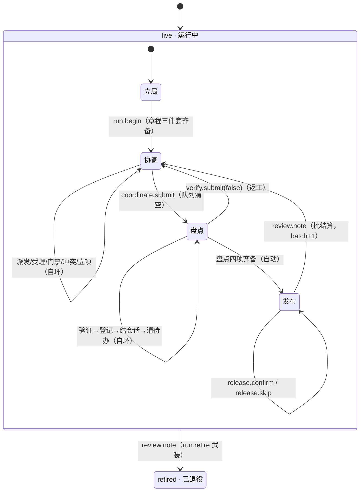
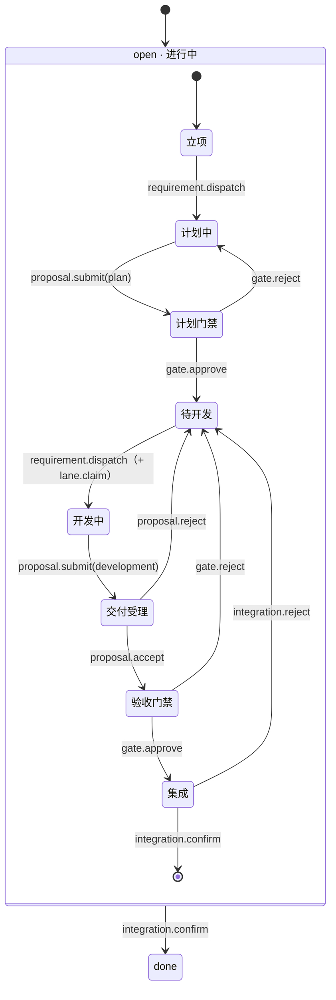

# Yggdrasill · 系统架构、行为语义与接口契约（`docs/DESIGN.md`）

> **定位**：`docs/DESIGN.md` 规定 Yggdrasill **始终最新的产品形态、系统行为、状态机语义与规范接口契约**——它是当前设计方案的权威快照，不是流水账：变更就地在对应章节改写，历史归 git 与结算产物，不进本文档。覆盖范围是**整个仓库**，按子系统分章节：内核（§3.1 Lua 宿主 API）、Mod（§3.2 包契约）、宿主 CLI/Daemon（§3.5 线协议）、serve 观察面（§3.7）等各有其章，修改哪个子系统就更新哪个章节。领域词汇、愿景、架构原则与决策台账（`D1–D20` 与 `D-MA` 系列台账，上界随台账顺延不写死）见 [`docs/CONTEXT.md`](CONTEXT.md)。为使本文档在实现重构下保持持久，其契约定义在边界层（**JSON Schema、CLI/JSON-RPC 线协议、Lua 沙箱宿主 API、事件 Payload、状态迁移表**），而非内部源码函数名或行号。
>
> **术语速览**：领域术语的完整定义见 [CONTEXT §2 核心领域词汇](CONTEXT.md#2-核心领域词汇)，本文档不再重复维护。
>
> **动作面分层**：Layer 2 的工具参数面契约（`ygg_session.action` 与 `event` / `op` 的分层、三类落点与硬不变量）见 [§3.4](#34-三层动作面契约event--op--action)。

---

## 1. 产品形态与三层系统边界

Yggdrasill 将确定性规则执行、声明式工作流语义与宿主环境集成分离为三个严格有界的层：

```text
┌────────────────────────────────────────────────────────────────────────────┐
│ Layer 2 · Presentation & Harness Adapter Shell                             │
│   - Game Clients: Web Browser (React + ygg-wasm), Godot 4 (gdext)          │
│   - Agent Adapters: 无内置执行壳（扩展层已删除，主会话直驱 egg CLI）      │
│     CLI Daemon Consumers (Claude Code / Codex / Cursor hooks)              │
│   Responsibilities: UI rendering, subagent process spawning/resuming,      │
│   context window telemetry & compaction, data red-line firewall.           │
├────────────────────────────────────────────────────────────────────────────┤
│ Layer 1 · Playable Mod Package (.ygg/mods/agent-seed, test-adventure)      │
│   - Executable Logic: Entry manifest (mod.lua) + pure modules (src/**)     │
│   - Declarative Resources: data/texts/*, data/config.json,                 │
│     data/playbook/*, pack.json, manifest.json                              │
│   Responsibilities: Two-layer state machine, gate predicates, reactive     │
│   hooks, tool reactors, narrative receipts, and HarnessAction projection.  │
├────────────────────────────────────────────────────────────────────────────┤
│ Layer 0 · Deterministic Rule Kernel, Sandbox & Storage Port                │
│   - Rule Kernel (ygg-core) + Schema Validator (ygg-schema)                 │
│   - Deterministic Lua 5.4 Sandbox & Host Contract (ygg-sandbox)            │
│   - Single-File Transactional Store & VFS (ygg-store -> run.sqlite)        │
│   Responsibilities: Atomic (state, event) -> state' transitions,           │
│   savepoint rollback, instruction fuel enforcement, VFS & tool bridging.   │
└────────────────────────────────────────────────────────────────────────────┘
```

### 1.1 跨治理引擎能力协商矩阵

由于 Layer 1（`agent-seed`）发出自包含的 `HarnessAction` 规格（`summary.jobs[i].subagentAction`），并经 Layer 0（`ygg.tool.call`）内联执行确定性仪式，任何编码 agent 宿主都能按其能力层级驱动 Yggdrasill：

| 层级 | 宿主环境 | 子代理执行与恢复 | 上下文遥测与压缩 | 集成机制 |
| --- | --- | --- | --- | --- |
| **Tier 1 · 主会话直驱** | Pi Coding Agent 等原生 Agent 宿主 | 主会话直驱 egg CLI + 原生 `Agent` 工具（`resume`），自动回退到 `fullFallbackBrief` | 实时 token 比例（`soft >= 60%`、`hard >= 75%`），稳定检查点写 `artifacts/handoff-latest.md` | 常驻能力 = 宿主原生 `egg --daemon` / `serve` |
| **Tier 2 · CLI / Hook 运行器** | Claude Code、Codex CLI、Cursor | 子进程调用或原生任务工具，消费 `subagentAction.brief` 与 `submitCommand` | 在稳定检查点由 Hook 触发的 `handoff_compact` | `egg --daemon` 或单次 `--resume --event` CLI |
| **Tier 3 · 提示委派** | 通用 LLM 聊天 / 自定义 Agent 循环 | 协调者把 `subagentAction.brief` 复制进子代理上下文并转达 `proposal.submit` | 经 `vfs.write` 手动检查点交接 | 单次 CLI 回执（缺省人读文本；`--raw` 显式旗标输出单行 JSON 信封）（`narrative` + `pendingChoice`） |

### 1.2 Adapter 一致性契约（任何 harness 都必须满足的五条义务）

三层架构的薄弱点在第 2 层：`subagentAction` 只是 `meta.summary` 里的**数据**，dispatcher 完全由 adapter 自行实现，于是「Mod 产出的 brief 被消费」不能只写成注释约定。本节把它固化为**可断言的义务规范**：落点由各 harness adapter 自行实现；本仓库当前无内置 adapter（执行壳已删除，主会话直驱 egg CLI + 原生 Agent 工具）。

| # | 义务 | 违反时的可见症状 |
| --- | --- | --- |
| **C1** | 派发给 subagent 的 prompt 必须含 `Mandatory references:` 与 `Submit:` 两条**行首锚线**（`^Submit:\s*\S` 要求后续非空） | 回执 `[ADAPTER CONTRACT] <rN> <stage>: …`，**不 spawn**，结果进 `degraded` |
| **C2** | `deltaPrompt` 若被单独使用，必须可判定；不可判定时**不得消费**（fail-closed），退回完整 `brief` | `delta-unassessable`；回执写 `[ADAPTER NOTE]` |
| **C3** | 任何一次派发都必须把**实际使用的 prompt 逐字节**落进 `artifacts/<rN>-<stage>-brief.md` | `[BRIEF REFUSED] <path>：<原因>` 进回执，并计入 `degraded` |
| **C4** | 归档/清理结论必须诚实：「查过且查空」或「没有库可查」才算证据，不得以「工具跑过」充当 `0/0`——不知道落点时宁可说没查，不谎报查空（现由 D-MA21 提示词方案承载，声明制见 §2.6 `settlement.sessions`） | 非证据态写 `sessions=0/0/unsettled:<kind>` |
| **C5** | 每一份 brief 都以 `## 续跑承接（Resume Handover）` 段收尾（`basis` / 前任执行者 / 未落地清单 / 硬约束 / 已归档制品） | `brief-missing-resume-handover`；无 `agentId` 时 `resume` 无法等价 |

**锚线为什么必须是「行首前缀」而不是 `includes`**：`job.description` 是多行需求正文，正文里完全可能出现 `Mandatory references: …` 这几个字，用任意 `includes` 判定会被一句话绕过——那是自指类断言的经典空转。**两条路必须同形状**：Core 的 `subagent_brief` 模板（`data/texts/` 片段装配）带这两行，adapter **本地拼装**的 brief 也必须带。**`resume` 的等价物是制品**（`artifacts/<rN>-<stage>.md` 加门禁证据），续跑承接段只是让下一个执行者（可能是另一个 harness、另一个上下文窗口）知道上一任为什么停在门外。

---

## 2. Mod 剧情与状态机语义

> 本章是 `agent-seed` Mod 行为语义的权威（D-MA23 剧情双层重写）。组织原则：**以剧情节点（微状态）为纲、以事件为推进货币**——每个节点的七项要素（主人 / 进入 / 幕内事件 / 退场 / 产出证据 / 拒绝 / 文案键）分布在：微状态表（主人、进入、退场、证据）、转场表（幕内与退场事件）、拒绝面矩阵（拒绝面）、beats 分组（文案键，§2.12）。两条设计目标：**压缩状态数量**（11 → 4 个真状态）与**主流程自循环**（协调 ⇄ 盘点 ⇄ 发布 → 下一批；终局只经显式退役）。

### 2.1 Mod 是什么（边界与纯度）

Mod 是一个**纯确定性状态机**：无 IO、无时钟、无随机（P8 / D13）。与外部世界的一切交互（git、文件、进程）都经宿主中介能力（`ygg.fs` VFS、`ygg.tool.call` 同步工具桥）发生，宿主未挂载时优雅降级且不破坏状态语义。

- **唯一写入口 = 事件**：`(state, event) -> state'`，全有或全无（P1）；事件之外不存在任何改状态的路径（L1 推进唯一性，§3.4）。
- **唯一输出 = KV + 叙事 + 菜单**：每次 dispatch 产出叙述回执（`ygg.narrate`）、持久化键值（`ygg.kv`）与至多一个 `pendingChoice` 菜单（`ygg.choice`）。
- **模块顶层纯度**（P6）：`src/**` 五层只导出纯函数与常量；处理器注册只发生在 `mod.lua` 装配入口。

### 2.2 双层结构与真状态压缩

状态分两层。**外层真状态**：内核 FSM 与需求状态机的持久化取值，压缩到 **4 个**。**内层微状态**（剧情节点）：由 KV 标志位经判定函数（§2.5）派生，不独立存储、不消耗转场预算。

真状态判据（满足任一条才配成为真状态）：

1. **跨越不可逆语义**——完成后不可回退（`done`、`retired`）；
2. **改变其他模块的全局行为**——退役后一切业务事件拒绝（`retired`），需求关闭后退出派发队列（`done`）。

| 层 | 载体 | 原状态（11 个） | 真状态（4 个） | 降级去向 |
| --- | --- | --- | --- | --- |
| 运行级 | `fsm.stage` | `coordinate` / `review` / `done` | **`live` / `retired`** | 协调/盘点/发布 → `run.phase` 微状态；`done` → `retired` |
| 需求级 | `req.<i>.status` | `draft`/`planning`/`developing`/`done` + `split`/`merged`/`dropped` | **`open` / `done`** | 进行中各态 → 九幕微状态；旁路 → `closed_reason` 字段（R11） |
| 提案级 | `prop.<j>.status` | 4 值 | 不变 | — |
| 泳道级 | `lane.<k>.*` | 3 值 | 不变 | — |

`coordinate` 与 `review` 来回切换、语义可逆——不满足任一判据，降为 `live` 的微状态；`draft` / `planning` / `developing` 同属「进行中」，降为 `open` 的微状态；`split` / `merged` / `dropped` 是**关闭原因**，降为字段（R11）。

### 2.3 运行级剧情（`live`）

`live` 是常驻自循环：立局 → 协调 ⇄ 盘点 ⇄ 发布 → 批结算 → 下一批，往复运行直到显式退役。**内核 FSM 唯一转场是 `live → retired`**（R1，`review.note` 武装路径经 `flow.advance` 盖章）。



**微状态表**（判定序见 §2.5；「主人=人 ⇒ 票据门」见 §2.13）：

| 微状态 | 判据 | 主人 | 进入 | 退场 | 产出证据 |
| --- | --- | --- | --- | --- | --- |
| **立局** | `run.phase == "charter"` | 人（局主） | run 创建（`initial=live`，`run.phase` 初值 `charter`） | `run.begin` | 章程三件套 `task.title/goal/success` |
| **协调** | 章程齐 ∧ `run.phase == ""` | 主代理 | `run.begin` / 批结算 | `coordinate.submit` | 需求交付物、门禁批注 |
| **盘点** | `run.phase == "settle"` | 主代理 | `coordinate.submit` | 盘点四项齐备（自动转发布） | 验证证据、演进登记、结算声明 |
| **发布** | `run.phase == "release"` | **主代理**（develop→master） | 盘点四项齐备 | `release.confirm` / `release.skip` → 批结算或退役 | `master@<sha>` + tag `vYYYY.MM.DD.N`，或跳过理由 |
| 退役（终态） | `stage == "retired"` | — | `review.note`（`run.retire` 武装） | — | `ending` |

**开场序列**（R3）：`event.start` 叙述 boot 三则（引擎/模式/红线）并可携带章程载荷写入 `task.*`，**不转场**；`charter.set` 仅立局可用、可反复修订；`run.begin` 前置 = 章程三件套齐备，落点 `run.phase=""` 并发 `[RUN BEGUN]`。章程在 `run.begin` 后**锁定**（R4）：`charter.set` 在非立局微状态一律可读拒绝。

**盘点内子微状态**（线性推进；`verify.submit(false)` 使整批退回协调并清 settlement 与 release 键，R9）：

| 子微状态 | 判据 | 只允许 | 文案键 |
| --- | --- | --- | --- |
| 待验证 | `verify.passed ≠ true` | `verify.submit` | `verify_green` / `verify_fail` |
| 待登记演进 | `verify.passed` ∧ 未注册 | `settlement.evolution` | `settlement_evolution` |
| 待结会话 | 已登记 ∧ `settlement.sessions.destination == ""` | `settlement.sessions` | `settlement_sessions` |
| 待清待办 | 已登记 ∧ `settlement.todo.remaining ≠ 0` | `settlement.todo` | `settlement_todo` |
| 可进发布 | 以上皆完成 | （自动转发布幕，不新增事件） | — |

**发布幕**（R-a / R10）：盘点四项齐备（验证、演进登记、会话清理、待办清理）后自动进入发布微状态（R9，效应驱动）。`release.confirm` 携带 `master@<sha>` 与批次 tag `vYYYY.MM.DD.N` 声明本批 develop→master 合并结果；`release.skip` 必填理由——本批无需发布的显式声明。两者任一成立即「发布已声明」；`review.note` 的前置即发布已声明（`run.release.master_sha ≠ ""` ∨ `run.release.skipped_reason ≠ ""`），未声明的批结算被可读拒绝。

`review.note` 两个落点（R10）：**未武装（常态）= 批结算**——`run.phase=""`、清 release 键、`run.batch+1`、`[BATCH n SETTLED]`（绝无 `[ENDING` 前缀）；**`run.retire` 武装 = 退役终局**——`advance(retired)` 写 `ending`，`[ENDING · run retired]`。

### 2.4 需求级剧情（`open`）

每个需求在 `open` 内走过九幕（微状态），第 9 幕 `done` 即终态。三条打回路径（交付受理 `proposal.reject`、验收门禁 `gate.reject`、集成 `integration.reject`）**统一落待开发**（R6：`plan_ok` 保持、`job=""`、释放泳道）。



**九幕微状态表**（判定序见 §2.5）：

| # | 微状态 | 判据 | 主人 | 进入事件 | 退场事件 | 产出证据 |
| --- | --- | --- | --- | --- | --- | --- |
| 1 | **立项** | 无 job ∧ 无门禁 ∧ 无待决提案 ∧ `plan_ok=false` | 人 | `requirement.add` | `requirement.dispatch` | 需求描述 |
| 2 | **计划中** | `job=="plan"` ∨ 有 pending plan 提案 | 执行者 | ↑ | `proposal.submit(plan)` | `artifacts/rN-plan.md` |
| 3 | **计划门禁** | `gate=="plan"` | **人** | ↑ | `gate.approve` / `gate.reject` | 门禁批注 |
| 4 | **待开发** | `plan_ok=true` ∧ `job==""` ∧ 无 pending | **资源**（泳道槽位） | `gate.approve` | `requirement.dispatch` | 泳道认领记录 |
| 5 | **开发中** | `job=="development"` | 执行者 | ↑ | `proposal.submit(development)` | `artifacts/rN-development.md` + `develop@<sha>` |
| 6 | **交付受理** | 有 pending development 提案 | 主代理 | ↑ | `proposal.accept` / `proposal.reject` | 受理记录 |
| 7 | **验收门禁** | `gate=="accept"` | **人** | `proposal.accept` | `gate.approve` / `gate.reject` | 门禁批注（须核验 `develop@<sha>`） |
| 8 | **集成** | `integrating=true` | 执行者 | `gate.approve` | `integration.confirm` / `integration.reject` | `develop@<sha>` 核验记录 |
| 9 | **done**（终态） | `status=="done"` | — | `integration.confirm` | — | 集成证据；旁路关闭时为 `closed_reason` |

保留「交付受理」的**不对称**（定稿 2026-11-12）：计划提案一过门禁即待开发，开发交付多一道主代理受理幕——开发交付的复核成本更高，受理幕是协调层的串行检查点。

**转场表**（副作用中的键见 §2.8；三条打回行 = R6 修正版）：

| 从 | 事件 | 到 | 副作用 |
| --- | --- | --- | --- |
| 立项 | `requirement.dispatch` | 计划中 | `job="plan"` |
| 计划中 | `proposal.submit(plan)` | 计划门禁 | `job=""`、提案落库、`gate_rev=rev` |
| 计划门禁 | `gate.approve` | 待开发 | `plan_ok=true`、`gate=""`；响应式自动派发可同回合续进开发中（§2.9） |
| 计划门禁 | `gate.reject` | 计划中 | `plan_ok=false`、`rev+1`、写 `feedback` |
| 待开发 | `requirement.dispatch` | 开发中 | `job="development"` + `lane.claim` |
| 开发中 | `proposal.submit(development)` | 交付受理 | `job=""`、提案落库、**不释放泳道**（R7） |
| 交付受理 | `proposal.accept` | 验收门禁 | stale 校验（`gate_rev==rev`）、复制 summary/artifacts |
| 交付受理 | `proposal.reject` | 待开发 | 提案置 rejected、`job=""`、释放泳道 |
| 验收门禁 | `gate.approve` | 集成 | `integrating=true`、`gate=""` |
| 验收门禁 | `gate.reject` | 待开发 | 写 `feedback`、`rev+1`、释放泳道 |
| 集成 | `integration.confirm` | done | 校验 `develop@<sha>`、`status="done"`、`LANES.release` |
| 集成 | `integration.reject` | 待开发 | 写 `feedback`、`integrating=false`、`LANES.release` |

**旁路与覆盖层**（不改幕，只改标志位）：`requirement.amend` 递增 `rev` 并使 `plan_ok` 失效——门禁挂起时 `gate_rev != rev` 呈现 stale、阻塞 `gate.approve`；修订 `done` 需求派生带 `origin=rN` 的新需求。`requirement.split` / `requirement.merge` 仅对开发前且无活动任务、门禁、泳道、冲突的需求有效——父/源需求落 `done` + `closed_reason`（R11）。`requirement.conflict` 在两需求间升起双向冲突（阻塞派发与收口），直到 `requirement.resolve`（`keep_both` / `keep_first` / `revise`）。`blocked`（冲突 / `needs_amend`）是 `req_display()` 叠加在 `req_phase()` 之上的**覆盖层**，不是微状态。

### 2.5 微状态判定的单一来源

菜单、文案、渲染、进度投影与文档全部从**两个函数**派生，任何消费方不得自带第二份状态名分支（这是「剧情读不出来」缺陷的根治——原判定散在 `requirements.lua` / `menus.lua` / `render.lua` / `review.lua` 四处）：

```lua
-- 运行级微状态（完整判定序；外层先判 stage==retired → 退役）
function run_phase()
  if STAGE == "retired" then return "退役" end
  local p = str("run.phase")
  if p == "settle"  then return "盘点" end
  if p == "release" then return "发布" end
  if p == "charter" then return "立局" end
  return "协调"                       -- p == ""：章程齐 ∧ 常驻主态
end
```

```lua
-- 需求级微状态（判据顺序即优先级；返回 closed 时由 closed_reason 区分旁路）
function req_phase(i)
  if req_status(i) ~= "open"       then return "closed"   end
  if flag(i, "integrating")        then return "集成"     end
  if req_gate(i) == "accept"       then return "验收门禁" end
  if has_pending(i, "development") then return "交付受理" end
  if req_job(i) == "development"   then return "开发中"   end
  if req_plan_ok(i)                then return "待开发"   end
  if req_gate(i) == "plan"         then return "计划门禁" end
  if has_pending(i, "plan") or req_job(i) == "plan" then return "计划中" end
  return "立项"
end
```

判定序的关键点：`integrating` 先于一切（集成幕是最近一次裁决）；**待开发先于计划门禁与计划中**——`plan_ok=true` 时即使有遗留 pending 提案也判待开发，三条打回路径的落点一致性由它保证；`closed` 不是幕名，由 `closed_reason` 区分正常交付与旁路关闭。

**中文名 ↔ 代码标识符映射（落地实现口径）**：两个判定函数在代码里返回**英文标识符**（菜单键 /
渲染键 / 摘要 `phase` 字段需要非空稳定键；`run.phase` 存储值 `""` 规范化为 `coordinate`），
文案面（拒绝理由 / 图例）经 `run_phase_label()` 换中文名。判定序与上两段伪码逐字一致：

| 层 | 代码标识符（判定函数返回） | 中文名（文案面） |
| --- | --- | --- |
| 运行级 | `retired` / `charter` / `coordinate` / `settle` / `release` | 退役 / 立局 / 协调 / 盘点 / 发布 |
| 需求级 | `draft` / `planning` / `plan_gate` / `ready` / `developing` / `dev_review` / `accept_gate` / `integrating` / `done` / `closed` | 立项 / 计划中 / 计划门禁 / 待开发 / 开发中 / 交付受理 / 验收门禁 / 集成 / 完成 / 旁路关闭（由 `closed_reason` 细分 `split` / `merged` / `dropped`） |

### 2.6 事件总表（38 个，三分类）

事件是唯一推进货币。三类切分：**剧情事件**（推进微状态，20 个）、**操作事件**（增删改查，8 个）、**基础设施事件**（10 个）。其中 6 个为 D-MA23 新增：`charter.set` / `run.begin` / `integration.confirm` / `integration.reject` / `release.confirm` / `release.skip`。

**剧情事件**（payload 契约与微状态落点；行内管道符均为转义字面量）：

| 事件 | 微状态落点 | payload |
| --- | --- | --- |
| `event.start` | live·立局（进入） | `""` 或 `"<title>\|<goal>\|<success>"`（可选章程载荷，R3；不转场） |
| `charter.set` | live·立局（内） | `"<title>\|<goal>\|<success>"`（可反复修订，R4 后锁定） |
| `run.begin` | 立局 → 协调 | `""`（前置：章程三件套齐备） |
| `requirement.add` | open·立项（进入） | `"<title>\|<description>[#deps]"` |
| `requirement.dispatch` | 立项 → 计划中 / 待开发 → 开发中 | `"rN"` |
| `proposal.submit` | 计划中 → 计划门禁 / 开发中 → 交付受理 | `"<req>\|<rev>\|<stage>\|<summary>\|<artifacts>\|…"` |
| `proposal.accept` | 交付受理 → 验收门禁 | `"pN"` |
| `proposal.reject` | 交付受理 → 待开发 | `"<pN>\|<reason>"` |
| `gate.approve` | 计划门禁 → 待开发 / 验收门禁 → 集成 | `"rN"` |
| `gate.reject` | 计划门禁 → 计划中 / 验收门禁 → 待开发 | `"<rN>\|<feedback>"` |
| `integration.confirm` | 集成 → done | `"<rN>\|develop@<sha>"` |
| `integration.reject` | 集成 → 待开发 | `"<rN>\|<reason>"` |
| `coordinate.submit` | 协调 → 盘点 | `""`（前置见 R8） |
| `verify.submit` | 盘点·待验证 | `"true"` / `"all_green=false;report=…"` |
| `settlement.evolution` | 盘点·待登记 | `"artifact\|summary[\|c=…][\|cls=…][\|sessions=…][\|todo=…]"` |
| `settlement.sessions` | 盘点·待结会话 | `"moved\|remaining\|destination"` |
| `settlement.todo` | 盘点·待清待办 | `"remaining\|basis"` |
| `release.confirm` | 发布 → 批结算 | `"master@<sha>\|vYYYY.MM.DD.N"` |
| `release.skip` | 发布 → 批结算 | `"<reason>"`（必填：本批无需发布的理由） |
| `review.note` | 发布 → 协调（未武装）/ → retired（武装） | `"lesson\|score"` |

`proposal.submit` 尾段链保留固定相对序 **`exec` → `actor` → `actor_session`**（各自可独立缺席）：`exec=<agent_id>[:<reason>]` 必须在链中 `actor=` 之前并同事务绑定执行者台账；`actor=` / `actor_session=` 由**宿主注入**（声明路由），调用方自带同名段在宿主侧即被拒（`ACTOR_FORGED`）——线协议正文见 §3.3，身份语义见 §2.13。

**操作事件**（8 个，不推进任何幕）：`requirement.list` / `requirement.split` / `requirement.merge` / `requirement.amend` / `requirement.conflict` / `requirement.resolve` / `lane.claim` / `lane.release`——只改操作对象与标志位（旁路语义见 §2.4 末段，泳道语义见 §2.10）。

**基础设施事件**（10 个）：`config.set` / `config.open` / `config.close` / `map.show` / `ygg.choice_selected` / `vfs.write` / `tool.call` / `tool.result` / `agent.summary` / `stage.advance`。

> 与 §3.4 末注的关系：末注的 registry 口径与复算命令描述**已装载 Mod 的事实集**；本表是 D-MA23 设计目标全集（既有 32 + 新增 6 = 38）。代码落地后两者一致；运行期 registry 仍是 fail-closed 的运行时唯一事实。

### 2.7 拒绝面矩阵

每个微状态的**拒绝面**与拒绝理由。拒绝一律走 `flow.refuse` 可读拒绝（`[REJECTED:*]` 前缀、`reject.*` 留痕），文案键按 beats 分组命名（§2.12）：

| 微状态 | 拒绝的事件 | 拒绝理由 |
| --- | --- | --- |
| live·立局 | 全部业务事件（requirement.*/proposal.*/gate.*/lane.*/coordinate.submit/settlement.*/review.note） | 章程未立，局不可开工（先 `charter.set` + `run.begin`） |
| live·协调 | settlement.* / review.note / release.*；integration.*（目标需求不在集成幕时） | 结算/发布/退役属盘点与发布幕；integration.* 前置=该需求处于集成幕 |
| live·盘点 | requirement.dispatch / proposal.* / gate.* / lane.* / coordinate.submit / release.* | 派发与门禁在盘点幕冻结（先完成盘点四项） |
| live·发布 | requirement.dispatch / proposal.* / gate.* / lane.* / coordinate.submit / settlement.* | 发布幕只认 release.* 与 review.note；`review.note` 另要求发布已声明 |
| live·retired | 全部业务事件 | 已退役（真状态判据②：全局行为改变） |
| open·立项 | proposal.* / gate.* / coordinate.submit（自身） | 未派发即无提案可交 |
| open·计划中 | proposal.accept / gate.* / 第二个 proposal.submit | 受理与门禁前置是提案已交 |
| open·计划门禁 | requirement.dispatch / 第二个 proposal.submit | 一次一门禁：先裁决挂起门禁 |
| open·待开发 | proposal.* / gate.* | 无在跑作业，无提案可受理 |
| open·开发中 | proposal.accept / gate.* / 第二个 proposal.submit | 受理与门禁前置是提案已交 |
| open·交付受理 | requirement.dispatch / gate.* | 门禁裁决以受理为前置 |
| open·验收门禁 | requirement.dispatch / 第二个 proposal.submit | 一次一门禁：先裁决挂起门禁 |
| open·集成 | requirement.dispatch / proposal.* / gate.* | 集成幕只认 integration.confirm / integration.reject |
| open·done | 除 list / amend / split / merge 外全部 | 终态只读（旁路迁移除外） |

### 2.8 状态存储契约

| 键 | 取值 | 作用 |
| --- | --- | --- |
| `fsm.stage` | `live` / `retired` | **唯一真状态（运行级）**；唯一转场 `live → retired` |
| `run.phase` | `charter` / `""` / `settle` / `release` | 运行级微状态标志（初值 `charter`，`event.start` 写入，R2） |
| `run.release.master_sha` | string | `release.confirm` 写入的 `master@<sha>` |
| `run.release.tag` | string | `release.confirm` 写入的批次标签 `vYYYY.MM.DD.N` |
| `run.release.skipped_reason` | string | `release.skip` 写入的理由 |
| `run.batch` | int（缺省 1） | 批计数 |
| `task.title` / `task.goal` / `task.success` | string | 章程三件套（`run.begin` 后锁定） |
| `req.<i>.status` | `open` / `done` | **唯一真状态（需求级）**；终态判定 = `status=="done"` |
| `req.<i>.closed_reason` | `""` / `split` / `merged` / `dropped` | 关闭原因（**字段，不再是状态**，R11） |
| `req.<i>.job` | `""` / `plan` / `development` | 在跑任务 |
| `req.<i>.gate` | `""` / `plan` / `accept` | 门禁挂起 |
| `req.<i>.gate_rev` | int | 门禁绑定的 rev（stale 判定） |
| `req.<i>.plan_ok` | bool | 立项 / 待开发的分界 |
| `req.<i>.integrating` | bool | 第 8 幕（集成） |
| `req.<i>.develop_sha` | string | `integration.confirm` 写入的集成证据 |
| `req.<i>.lane` / `rev` / `conflict*` / `needs_amend` / `feedback` / `artifacts` / `summary` / `hist` | 各式 | 沿用（见 §2.4 / §2.10） |

**删除**（D-MA23）：`R_ANALYZING`、`PHASE`（14 名派生表）、`analysis` 提案槽、`fsm.stage` 的 `coordinate`/`review`/`done` 三值。旧局存档真状态取值变化 → 不兼容，不迁移、开新局（r9 升级纪律）。

### 2.9 响应式推进契约

在发出 `pendingChoice` 之前，Mod 按确定性的注册顺序冲刷已注册的响应式效应（`useEffect`）——`render()` 顶部、`flush_effects`，最多 `MAX_PASSES = 4`，不收敛即为硬错误。每个效应必须遵守四条不变量：

1. **唯一声明后继**：迁移确定性且只在一处声明；`useMemo` 依赖必须是 KV 派生标量（状态/作业/待决/就绪/计数），保存重载后可复算，不依赖 Lua 内存 diff。
2. **零外部判断**：无需人类批准或未挂载的外部 I/O（无文件读、无会话状态）。
3. **绝不绕过门禁**：五个里程碑动作（`proposal.accept` / `gate.approve` / `coordinate.submit` / `verify.submit` / `review.note`）绝不由效应触发；效应不推进任何「主人=人」的幕。
4. **无渲染的效应**：效应可改变 KV 并 `ygg.narrate`，但绝不调用 `render()` 或 `ygg.choice`。

现行效应清单（全部满足四不变量）：`auto_dispatch`（`gate.approve(plan)` 后将刚变待开发的需求在同回合自动派发 development，条件 = 无待决提案/门禁/冲突且槽位空闲）；`tools.receipt` / `tools.reactive`（工具回执落账与结果折叠，§2.10 / §2.11）；**盘点收口效应**（R9：盘点四项齐备自动转发布幕——判据纯 KV、无外部证据、非门禁动作、不渲染，「唯一声明后继」的又一实例）。

### 2.10 持久化泳道池与实时进度投影

- **非破坏性认领（`worktree-claim`）**：分配 `<repo-parent>/worktrees/<repo>-lane-<k>`（`k ∈ 1..4`）。worktree 已存在且已跟踪工作树干净时 `git checkout -B <branch> HEAD`，使未跟踪构建缓存（`target/`、`node_modules/`）跨任务存活。
- **非破坏性释放（`worktree-release`）**：验证干净后 `git checkout --detach HEAD`，解锁分支而不删除目录。
- **强制分支命名（`branch_problem`，r2）**：泳道分支必须满足 `feature/{4位uuid}-{语义词段}`——小写 4 位 uuid 段 + 语义词段（≥3 连续字母、非纯数字、8–16 位纯 hex 拒绝、总长 ≤48、前缀大小写敏感）。`lane.claim` 与 `git.worktree_claim` 两条入口同规则、拒绝通道不同：前者走 `flow.refuse` 可读拒绝（`reject.count/last` 留痕），后者走叙事拒绝；未自报名 = 可读拒绝，不生成默认名。
- **泳道绑定窗口（R7）**：`待开发 → 开发中` 认领；保持到 集成 confirm/reject、验收门禁 reject、交付受理 reject 或 done 才释放。`交付受理 → 验收门禁 → 集成` 三幕期间**不释放**——执行者仍需该工作树完成 feature→develop 集成（D-MA22）。
- **执行者身份投影（r3）**：`requirement.list` trace 并列三态互证后缀（`[verified]` / `[mismatch:actor=…]` / `[unverified]`，判定只看 `exec=` vs 宿主 `actor=` 章）；`agent.summary.profiles` 数组（≤8 张，handle 升序）投影 profile 注册表（自报身份卡，与账本互链不冗余，见 §2.13）。
- **实时状态投影**：`requirement.list` 与 `summary.jobs[]` 每行需求投影三条从 KV 派生的实时状态串：
  - `worktreeStatus`：`"n/a"` | `"pending"` | `"ready:<path>@<branch>"` | `"bound:lane-<k>@<branch>"`
  - `subagentStatus`：`"idle"` | `"pending"` | `"dispatched:<agent_id>"` | `"delivered:p<N>(<agent_id>)"`
  - `probeStatus`：`"n/a"` | `"pending"` | `"verified:commits=<N>,clean=<0|1>"`

### 2.11 工具桥契约

同步工具桥（`ygg.tool.call`）受**双层白名单**约束：`pack.json` `tools`（Layer 1 能力面，装载期宿主强制）与 `data/config.json` `allowedTools`（Layer 2 发布面，请求期 Mod 强制，必须为前者超集）——契约正文与诚实声明见 §3.2 / §3.4，本节不重复。反应器边界（只写 KV + 叙事、探针失败是警告不是门禁、机证与人证同级）见 mod README 的三条硬边界。

### 2.12 提示词面（beats）契约

叙事文案与提示词全部存放在 `data/texts/` 片段（350 个 beats 键 + core），按域分组、单一职责（P2 零硬编码；`mod.lua` 装配回 TEXTS）：

| 片段 | 键数 | 职责 |
| --- | --- | --- |
| `beats-flow.json` | 50 | 回执版式、guide/goal 提示、拒绝文案（`rejected*` / `stage_expected`） |
| `beats-requirements.json` | 132 | 需求族文案：派发/提案/门禁/打回/依赖校验/九幕行文 |
| `beats-lanes.json` | 29 | 泳道账本、认领/释放、分支命名拒绝 |
| `beats-map-guide.json` | 40 | 地图视图、菜单行、人机门禁提示 |
| `beats-settlement.json` | 37 | 盘点四项、批结算、退役、发布幕文案 |
| `beats-harness.json` | 62 | 配置面板、身份注册、工具桥提示、`subagent_submit_cmd` 模板 |
| `core.json` | — | `scenes`（3）/ `endings`（1）/ `prompts`（2）/ `options`（23）/ `tuning`（8） |

文案键归属随微状态走（§2.7 的拒绝文案、各幕行文键在 `beats-requirements` / `beats-settlement`）；新幕（立局/集成/发布）的文案键由后续代码任务对齐本表。

### 2.13 身份与权限（不进剧情）

两套身份机制 + 一套人机门禁。**定性**：它们**不改变任何微状态**——是事件的**准入校验与留痕**，落在 payload 尾段（§2.6）、进度投影（§2.10）与事件日志；剧情推进只认 §2.4 转场表。每个微状态的「主人」字段 = 人 ⇒ 该动作走票据。

- **执行者台账**（`settings.executor.<rN>.<stage>`，stage ∈ `plan` / `development`）：自声明的审计轨迹，值 `<agent_id>[:<reason>]`；同一 (需求， 阶段) 换人或跨阶段交接到不同 id 必须带原因。占位 id（`main` / `default` / `unregistered`）在恢复决策中被过滤。台账是**权责权威**（谁执行了这一幕），不做身份认证。
- **提交者身份章**（宿主注入 `actor=` / `actor_session=`）：解析链 `--actor` > `YGG_ACTOR` > daemon 请求字段；mod 侧三态互证（`exec=` vs `actor=`：`[verified]` / `[mismatch]` / `[unverified]`）**识别不拒绝**——裁决权留在人与门禁。`actor_session` 是纯审计字段，永不参与判定。诚实威胁模型：防误记与张冠李戴、让冒用可见可审计，不做密码学（D-MA12）。
- **profile 卡**（`profile.<handle>.*`）：`config.set` 逐键注册的自报身份卡（`harness` / `session_id` / `role` / `assignments`），回答「这个句柄是谁」；与台账互链不冗余（渲染层字符串 join，权责仍以台账为准）。
- **人机门禁**（`HUMAN.ACTIONS`，5 个，维持不动，R5）：`proposal.accept` / `gate.approve` / `coordinate.submit` / `verify.submit` / `review.note`。`guide` 模式下**只收菜单票**（`ygg.choice_selected` 回复索引），直发一律拒绝；`goal` 模式下主代理读完整回执后自行派发（`goal.authorization` 逐局登记，证据标准不变）。新事件（`charter.set` / `run.begin` / `release.*` / `integration.*`）不进票据门：`integration.*` 由执行者发（执行者结构上无菜单），`release.*` 由主代理直发（与 `settlement.*` 同口径）。

---

## 3. 接口契约（规范线协议与 API 面）

### 3.1 Lua 沙箱宿主 API 契约（`ygg.*`）

Lua 5.4 沙箱只暴露安全标准库（`base`、`table`、`string`、`math`、`utf8`、`coroutine`）外加冻结的 `ygg` 全局表：

| API 面 | 签名与返回契约 | 副作用类别（`YGG-MOD-EFFECT`） |
| --- | --- | --- |
| `ygg.on(event_name, handler_fn)` | 注册事件处理器 `function(payload)`。`mod.lua` 加载完成后即封存；在运行时或子模块顶层调用即为错误。 | **模块顶层禁用**（仅入口 `mod.lua` 或 `M.install`） |
| `ygg.emit(event_name, payload)` | 入队一个内部派生事件（FIFO，受 `max_cascade_depth` 上限约束）。若在同一处理器中 `ygg.choice` 之后调用则被丢弃（`YGG-R1`）。 | **模块顶层禁用** |
| `ygg.narrate(text)` | 向当前迁移的临时叙述回执缓冲区追加一行。 | **模块顶层禁用** |
| `ygg.choice(prompt, options_array)` | 将 `pending_choice` 写入状态并**立即**通过哨兵错误终止当前处理器。玩家选择以新外部事件 `ygg.choice_selected`（1 基整数索引）到达。 | **模块顶层禁用** |
| `ygg.meta(key, json_value)` | 将结构化元数据（`summary`、`tool_calls`、`harness_actions`）写入当前 dispatch 回执的临时 `meta` 映射。 | **模块顶层禁用** |
| `ygg.data(resource_id)` | 纯读取，返回 `pack.json` `entries` 中声明的、经 Schema 校验的 JSON 资源的深度 Lua 表副本。 | 模块顶层允许（纯读取） |
| `ygg.kv.get(key)` / `ygg.kv.set(key, val)` | 读取或写入持久化键值状态（`nil`、`boolean`、`number`、`string` 或可 JSON 序列化的表）。处理器失败时回滚。 | `get` 允许；`set` **模块顶层禁用** |
| `ygg.entity.*` | `spawn()`、`exists(id)`、`destroy(id)`、`get_attribute(id, k)`、`set_attribute(id, k, v)`、`add_tag(id, t)`、`remove_tag(id, t)`、`has_tag(id, t)`。返回数字实体 ID（`YGG-R2` 要求将 ID 持久化到 `ygg.kv`）。 | 查询允许；变更 **模块顶层禁用** |
| `ygg.fsm.*` / `ygg.narrative.*` | 内嵌 Lua 标准库辅助，用于扁平有限状态机（`fsm.define`、`fsm.current`、`fsm.on_event`）与故事节点（`narrative.node`、`narrative["goto"]`；点形式 `narrative.goto` 是 Lua 5.4 语法错误，由 `YGG-R3` 捕获）。 | `define` / `node` / `goto` **模块顶层禁用** |
| `ygg.fs.{write,read,stat,list}` | 可选宿主注入的 VFS 接口，严格限定于 `artifacts/*.md`。`write(path, content)` 返回 `{ bytes, sha256 }`。 | 变更调用 **模块顶层禁用** |
| `ygg.tool.call(tool_id, args_table)` | 可选同步宿主工具桥。挂载时内联执行白名单工具并返回 `{ ok = true, data = { ... } }` 或 `{ ok = false, error = "..." }`。未挂载时返回 `{ ok = false, unmounted = true }`，使 Mod 回退到异步 `meta.tool_calls`。 | **模块顶层禁用** |

### 3.2 Mod 包与多文件纯度契约（`pack.json`、`manifest.json`、`data/*`）

一个 Mod 包目录包含：

1. **`pack.json`（编写与宿主契约声明）**：
   - `id`、`version`、`engineVersion`（semver 范围）、`seed`、`limits`（`maxFuelPerDispatch`、`maxCascadeDepth`、`maxMemoryBytes`）。
   - `code`（可选）：`{ "entry": "mod.lua", "modules": ["src/core/util.lua", ...] }`。当存在时，`entry` 不得出现在 `modules` 中，且每个模块 chunk 顶层由 `ygg_modules::effects` 强制为纯。
   - `entries`：声明式资源清单（数组，每项 `{ id, kind, schema, path }`），逻辑资源按域拆片声明：一个 `agent-config`（`data/config.json`）+ 若干 `scene-texts-fragment`（`data/texts/*.json`，由 `mod.lua` 装配回 TEXTS）+ 若干 `agent-playbook-fragment`（`data/playbook/*.json`）；片段数随内容演进，以 `pack.json` 为准。
   - `agent`：8 个必填字段（`entryEvent`、`choiceEvent`、`summaryEvent`、`endingPrefix`、`metaKey`、`rejectionPrefixes`、`replayPrefix`、`defaultPayload`）。
   - `inboxRoutes`：声明 `idField`、`externalIdField`、`kindField`，以及每 kind 的 `{ event, fields[] }` 映射，用于异步 JSONL 收件箱摄入；需要宿主注入提交者身份的动作可声明 `actor` / `actor_session` 布尔（r3，缺省 false = 功能关闭）。
   - `tools`（可选，**Layer 1 能力白名单**）：将 `<namespace>.<name>` 映射到 `{ kind: "cli" | "http", program, args[], timeoutMs, maxOutputBytes, readOnly, resultEvent }`。占位符用 `{{arg}}` 表示调用参数，用 `$ENV{VAR}` 表示宿主侧密钥解析。
2. **`data/config.json`（运行时默认值与 Layer 2 发布白名单）**：
   - 依据 `packages/schema/schemas/agent-config.json` 校验。
   - 声明 `play.mode`（`"guide"` | `"goal"`）、`evolution`（`mode`、`allow_paths`、`max_per_run`）、`gates.require_all_green`、`drive`（`maxSteps`、`stagnationLimit`、`decideTimeoutMs`）、`settlement`（`requireNonEmptyEvents`、`requireZeroFailedSteps`、`requireEnding`、`requireInboxConsumed`）、`allowedTools`（**Layer 2 发布白名单**，必须是 `pack.json` `tools` 键的超集），以及可选的 `harness` 适配器元数据。
3. **`manifest.json`（内容寻址完整性锁）**：
   - 依据 `packages/schema/schemas/manifest.json` 校验。为每个代码文件与数据资源记录 `{ path, sha256, byteLength }`。经 `./scripts/sync-seed-mod.sh` 维护。

### 3.3 事件 Payload 线协议契约

派发到 `agent-seed` 的所有事件使用管道分隔（`|`）的 UTF-8 字符串 payload（在支持处附带可选尾随 `@ext=<id>` 幂等键）：

| 事件名 | 线协议 Payload 格式 | 契约与校验规则 |
| --- | --- | --- |
| `event.start` | `""`/`"0"` = 无载荷 boot；`"<title>\|<description>"` = 章程载荷 | 无载荷照常 boot（章程显示 (untitled task)）；有载荷同拍写 `task.title`/`task.description` 并落 `coordinate`；已在 `coordinate` 再带载荷 = 幂等补写不过段（r2 rev2 B 裁决）。 |
| `requirement.add` | `"<title>\|<description>[\|<ext_id>[\|<dep1,dep2>]]"` | 在 `draft` 中添加 `rN`。校验 DAG 无环与 `ext_id` 幂等。 |
| `requirement.dispatch` | `""` \| `"0"` \| `"rN"` | 派发就绪需求，最多达 `job_capacity`（4）。`draft` 行进入 `planning`；`ready`（`planning` + `plan_ok`）行认领泳道并进入 `developing`。 |
| `proposal.submit` | `"<req_id>\|<rev>\|<stage>\|<summary>\|<artifacts>\|[<changes>]\|[<ext_id>][\|exec=<agent_id>[:<reason>]][\|actor=<actor_id>][\|actor_session=<session_id>]"` | 提交针对 `analysis`、`plan` 或 `development` 的提案。保留尾段链固定相对序 `exec → actor → actor_session`（各自可独立缺席）：`exec=` 必须在链中 `actor=` 之前并同事务绑定执行者台账；`actor=` / `actor_session=` 由**宿主注入**（声明路由 + `--actor` / `YGG_ACTOR` / daemon 请求字段），调用方自带同名段在宿主侧即被拒（`ACTOR_FORGED`），mod 侧错位段逐段点名拒绝；三态互证（verified / mismatch / unverified）识别不拒绝，`session` 是纯审计字段永不参与判定（见 §3.7）。 |
| `proposal.accept` | `""` \| `"0"` \| `"pN"` \| `"rN"` | 接受头部（或指定的）待决提案。在 `guide` 模式下需要菜单票据。 |
| `proposal.reject` | `"<pN_or_rN>[\|<reason>]"` | 拒绝待决提案并将需求返回其阶段队列。 |
| `gate.approve` | `""` \| `"0"` \| `"rN[\|<note>]"` | 通过 `plan_gate`（$\to$ `ready` + 响应式自动派发）或 `accept_gate`（$\to$ `done` + 内联泳道释放）。要求 `gate_rev == req.rev`，且对 `accept_gate` 要求非空 `artifacts`。 |
| `gate.reject` | `"<rN>[\|<feedback>]"` | 拒绝 `plan_gate`（`plan_ok=false`）或 `accept_gate`（保留 `plan_ok`），递增 `rev`，并返回 `planning`。 |
| `requirement.amend` | `"<req_id>\|<title>\|<description>\|<deps>"` | 空段保留当前值；`deps="-"` 清空依赖。递增 `rev`。 |
| `requirement.split` | `"<parent_id>\|<child_title_1>\|<child_title_2>[\|...]"` | 将一个开发前需求拆分为 $\ge 2$ 个 `draft` 子需求。 |
| `requirement.merge` | `"<rA,rB>\|<merged_title>\|<merged_desc>"` | 将 $\ge 2$ 个开发前需求合并为一个带并集依赖的新 `draft` 需求。 |
| `requirement.conflict` | `"<rA,rB>\|<note>"` | 将两个需求标记为 `blocked`，直到解决。 |
| `requirement.resolve` | `"<rA,rB>\|<keep_both\|keep_first\|revise>[\|<note>]"` | 清除冲突并应用所选解决策略。 |
| `coordinate.submit` | `""` \| `"0"` | 当所有关闭前置条件满足时，从 `coordinate -> review` 推进（**批边界**）。 |
| `verify.submit` | `"all_green=<true\|false>[;report=<text>]"` | 在 `review` 中记录验证结果。 |
| `settlement.evolution` | `"<artifact>\|<summary>[\|c=<kept>/<screened>[\|cls=<kind>:<n>,...]][\|sessions=<moved>/0/<dest>][\|todo=0/<verified_by>]"` | 在一个事务中注册演进筛选并结算会话/todo 清理（**每批一次**）。 |
| `review.note` | `"<lesson>\|<score_1_to_5>"` | 将 `settlement.evolution.*` 归档进 `review.evolution.*`；未武装 = 批收口回 `coordinate`（`run.batch` +1，无 `[ENDING`），`run.retire` 武装 = 退役终局（`[ENDING · run retired]`）。 |
| `config.set` | `"<key>=<value>"` | 更新运行时 `settings.<key>`（`play.mode`、`goal.authorization`、`run.retire`（`true`/`""` 退役武装/解除）、`executor.<rN>.<stage>`、`evolution.mode`、`gates.require_all_green`、`review.evolution.*`）。 |
| `vfs.write` | `"artifacts/<name>.md\|<content>"` | 经 `ygg.fs.write` 将内容写入 `run.sqlite`（`vfs_files`），并在 `artifact.*` 中记录 SHA-256 + 字节长度。 |

### 3.4 三层动作面契约：`event` / `op` / `action`

Yggdrasill 的动作面被严格分成三层，任何一层都不得越权承担另一层的职责。这三个词在本文档后文一律按此定义使用，不许混用。

| 层 | 载体 | 值域 | 权威来源 | 职责边界 |
| --- | --- | --- | --- | --- |
| **L1 `event`** | `ygg.on(event_name, handler)` 注册的 handler（`stage.advance` 由 `ygg.fsm.define` 转手注册） | 32 个事件名（全集见本节末注，payload 位次见 §3.3；`guide.show` 已随 r1 注销、`task.intake` 已随 r2 rev2 注销） | Mod（`.ygg/mods/agent-seed/src/**`（core/domain/view/runtime/handlers 五层）、`mod.lua`） | **唯一的状态推进货币**：`(state, event) -> state'`，全有或全无（见 CONTEXT `P1`）。事件之外不存在任何改状态的路径。 |
| **L2 `op`** | daemon JSON-RPC 请求的 `op` 字段 | `ping` / `summary` / `dispatch` / `vfs_put` / `vfs_get` / `vfs_list` / `settle` / `shutdown`（8 个） | Rust 宿主（`crates/ygg-sandbox/examples/egg.rs`）；线协议见 §3.5 | **状态推进之外的旁路能力**：制品读写、摘要查询、结算报告、进程控制。`op=vfs_put` 与 `event=vfs.write` 是**两条平行端口**，互不经过对方，且语义不等价（见下文对照表）。 |
| **L3 `action`** | `ygg_session` 工具的 `action` 参数（`StringEnum`） | `kickoff` / `dispatch` / `approve_gate` / `reject_gate` / `vfs_write` / `vfs_read` / `vfs_list` / `handoff_compact` / `settle_close`（9 个） | 各 harness 适配器（本仓库无内置，执行壳已删除）；L3 由各 harness 自行定义，值域随适配器可变，不是跨 harness 契约 | **面向模型/人的语义入口**：它只决定「用哪个动词说出意图、由谁拼 payload」，**不决定状态**。值域随适配器可变，**不是**跨 harness 契约。 |

一句话边界：**`event` 决定状态能不能变；`op` 决定旁路能力能不能用；`action` 只决定模型怎么用一句话说出它想干什么。** 因此 `action` 的值域永远可以变，`event` 与 `op` 的值域基本不能变——重叠发生在哪一层，就只在哪一层可能是冗余。

#### 三条硬不变量

1. **I1 · 推进唯一性**：任何 `action` 都**不得**绕过 `op=dispatch` → Mod handler 去改状态。适配器里没有第二套状态机，也没有第二份状态投影。
2. **I2 · 状态不可写性**：适配器**绝不**直接写 `run.sqlite` / `settings.*` / `req.*` / `stage`。`stage` 由 `ygg.fsm` 独占写；其余领域键只由 Mod handler 写（`ygg.kv.set` 的全部领域键都落在 `src/handlers/**` 内）。
3. **I3 · 拒绝不可洗白**：Mod 的回执一旦带 `agent.rejectionPrefixes` 命中的行（`[REJECTED:*]` / `[BLOCKED:*]`），适配器必须**原样回贴**并停止该步的后续编排，绝不复述为成功，也绝不重试到看起来通过。

#### `action` 面的四类落点（每个 `action` 必须可归入且只归入一类）

| 类别 | `action` | 落点 | 允许的 dispatch 次数 |
| --- | --- | --- | --- |
| **A1 · 多步编排** | `kickoff`、`settle_close` | 多个 `event`（`settle_close` 另含 `op=vfs_put` 与 `op=settle`） | $\ge 2$，且**任一步被拒即停** |
| **A2 · 单 event 便利别名** | `approve_gate` → `gate.approve`、`reject_gate` → `gate.reject` | 单个 `event` | 1 |
| **A3 · 事件直通** | `dispatch` | 任意 `event`，payload 由调用方给 | 1 |
| **A4 · 非 event 旁路** | `vfs_write` / `vfs_read` / `vfs_list` → `op=vfs_put` / `op=vfs_get` / `op=vfs_list`；`handoff_compact` → 纯适配器本地（`op=vfs_put` + 宿主压缩） | 0 个 `event` | 0 |

A1 的正确性依赖适配器对 Mod 内部语义的理解（例如 `kickoff` 里 `goal.authorization` 必须先于 `play.mode=goal`，`settle_close` 里 `verify.submit` → `settlement.evolution` → `review.note` 的顺序与 `sessions=` 段的幂等判断）——这条顺序契约**写在适配器里**，Mod 侧不会替它兜底。

#### A2 的准入判据

**当且仅当一个 `action` 能防止一类具体的、可命名的 payload 错位时，它才配拥有一个别名**，并须在适配器的契约测试里以断言钉住。

`approve_gate` / `reject_gate` 命中此判据：`reqId` 必填可防止「漏 `reqId` 时 Mod 退化去批门禁队列里的下一个待批门」——那是**批错需求**的正确性问题，不是省 token；两者把 payload 拼成 `"rN|<note>"`，空 `note` 也必须产出 `"rN|"` 而不是 `"rN"`（位次见 §3.3）。除此之外的 `action` 都没有第二条等价 `event` 路径，因此**不存在可消除的功能重叠**。同一条判据也否掉了零增量别名：一个连「能防哪类具体错误」都答不出来的 `action`（只是另一个名字的同义重复）应当退场，而不是无限期挂着当兼容残留。

#### `dispatch` 与压缩的边界

`dispatch` 的语义严格是：**派发一次事件，返回该次派发的完整回执**。它**不得**附带任何「回合后动作」，尤其不得触发上下文压缩——`ctx.compact()` 会 abort 当前回合，而 §1 与 CONTEXT 都要求「回执整段可见」，两者不可能同时成立。

- 因此 `dispatch` 分支对上下文压力**只报告、不压缩**：回执里给出水位、稳定节点判定与「需要时显式调 `handoff_compact`」的提示。
- 压缩只允许在两个**显式入口**发生：① `action=handoff_compact`（强制，见 §3.6）；② `ygg_run_lanes` 的编排层刹车（编排层已经落下本波并写好交接单之后）。
- 自动触发的水位判断最多只能**报告**，不能自己压。

#### `op=vfs_put` 与 `event=vfs.write` 的不等价（不得互相替代）

同一份字节可以经两条路进 VFS，但只有事件路径带语义守卫与台账：

| 维度 | `event=vfs.write`（走 `action=dispatch`） | `op=vfs_put`（走 `action=vfs_write`） |
| --- | --- | --- |
| 阶段守卫 | `stage == done` 时**拒绝** | **无**（收口后仍可写） |
| 内容上限 | `MAX_VFS_CONTENT` = **64 KiB**（`65536` 字节），超出即 `reject_payload` | 宿主 `validate_artifact_content` = **256 KiB** |
| 路径狱 | `artifacts/<name>.md`、$\le 128$ 字节、无 `..`、无空白（`artifact_path_ok`） | 宿主 `validate_artifact_path`：`artifacts/` 前缀、$\le 128$ 字节、只允许 `[A-Za-z0-9._/-]`、不得含 `..`、不得有空路径段；**不强制 `.md`** |
| `artifact.*` 台账 | **写**（`record_artifact(path, bytes, sha, source="vfs")`，供 `fs.artifact_probe` 与收口核验读取） | **不写**（只 `artifact_put` 落库 + `vfs_load` 灌进内核 `ygg.fs`） |
| `ygg.fs` 缺席时 | `[VFS LEDGER ONLY]` 降级：照样记台账、照样叙事，不声称落盘 | 由宿主直接落库并 `vfs_load`，不存在这次降级 |

结论：凡需要进入 `artifact.*` 台账、需要阶段守卫或 64 KiB 上限的制品，**必须**经 `event=vfs.write`；`op=vfs_put` 只用于「不参与台账」的宿主侧归档（例如交接单 `artifacts/handoff-latest.md` 与 `settle_close` 的进化复盘）。这两个名字长得像，但**不是**同一个原语的两种写法。

#### 本节末注 · `event` 全集（32 个）

`agent.summary`、`requirement.add` / `requirement.list` / `requirement.dispatch` / `requirement.amend` / `requirement.split` / `requirement.merge` / `requirement.conflict` / `requirement.resolve`、`lane.claim` / `lane.release`、`proposal.submit` / `proposal.accept` / `proposal.reject`、`coordinate.submit`、`verify.submit`、`settlement.evolution` / `settlement.sessions` / `settlement.todo`、`review.note`、`gate.approve` / `gate.reject`、`config.set` / `config.open` / `config.close`、`map.show`、`ygg.choice_selected`、`event.start`、`tool.call` / `tool.result`、`vfs.write`、`stage.advance`。

计数口径（可复核）：前 31 个由 Mod 直接调用 `ygg.on(...)` 注册；`stage.advance` 是第 32 个，它由 `ygg.fsm.define`（`crates/ygg-sandbox/stdlib/fsm.lua`）转手注册，**不在** `ygg.on` 的字面出现处。可执行复算：`grep -rn 'ygg\.on("' .ygg/mods/agent-seed/ | sed 's/.*ygg\.on("\([^"]*\)".*/\1/' | sort -u` 得到 31 项，再加上 `mod.lua` 的 `ygg.fsm.define` 声明里那一项 `event = "stage.advance"`，合计 33。这 33 个事件构成状态机的完整原子转换集合；`action` 面**从不**表示「这 33 个之外还有别的状态转换」。运行期 registry = 这 33 个 + stdlib 内置注册面（`ygg.narrative.goto`，合计 34）；registry 之外的事件名（含拼错的名字与未注册的 `ygg.*`）派发一律 **fail-closed**——外部名在门面预检零副作用拒绝（可读 VALIDATION，文案带已注册全集），派生名（handler `ygg.emit`）使整次转换失败回滚。registry 是运行时唯一事实，宿主不持任何事件名白名单。

### 3.5 宿主 CLI 与 Daemon JSON-RPC 线协议契约

> `op` 面的 8 个操作是状态推进之外的旁路端口；`op=vfs_put` 与 `event=vfs.write` 的语义差异（阶段守卫 / 内容上限 / 台账）见 §3.4。

#### 单次 CLI 与内置工具参数（`egg`）
- **运行执行**：`.ygg/bin/egg --mod <mod_dir> --run-id <id> --runs-root .ygg/runs [--resume] [--raw] --event <event> [--payload <json>]`
  - **回执渲染口径（r5）**：缺省为人读文本渲染；`--raw` = 单行 JSON 机器契约（与历史缺省逐字节一致）；解析链 `--raw` > `YGG_FORMAT`（text\|json）> 缺省 text；不改字段契约、退出码与 daemon 协议面。脚本 / CI 解析单发 stdout 必须加 `--raw`（或环境级 `export YGG_FORMAT=json`）。
- **单发派发的未注册事件（fail-closed，r11）**：`--event <name>`（或省略时的 `entryEvent`）不在 Mod registry 内时，派发在**零副作用**下拒绝（不进回放日志、不耗燃料、不动状态基线）：回执 `ok:false` + `error.code=VALIDATION`，`message` 三要素（事件名原样 + 已注册计数 + 已注册全集字典序），退出码 1，审计行 `ok=false` 照写。`ygg.*` 保留事件同样只认 registry（宿主不持事件名白名单）；空/空白事件名仍走参数面（usage / DAEMON 层），与本语义分层。
- **结算**：`.ygg/bin/egg --mod <mod_dir> --run-id <id> --runs-root .ygg/runs --settle`
- **内置宿主工具（`--builtin-tool <op>`）**：
  - `worktree-claim --lane <1..4> --req <rN> --branch <branch> [--repo <path>]` $\to$ `lane=<k>;req=<rN>;branch=<br>;base=<sha>;clean=1;path=<wt_path>`
  - `lane-probe --lane <1..4> --base <sha> --branch <branch> [--repo <path>]` $\to$ `lane=<k>;commits=<N>;clean=<0|1>;head=<sha>;files=<csv>`
  - `worktree-release --lane <1..4> [--repo <path>]` $\to$ `lane=<k>;released=1;idle=<0|1>`
  - `artifact-probe --path artifacts/<name>.md [--run-dir <dir>]` $\to$ `path=<p>;exists=<0|1>;bytes=<N>;sha256=<hex>`
  - `verify-suite [--mode fast|full] [--repo <path>]` $\to$ `passed=1;summary=<M>/<M>`（在回退到默认 Rust cargo 门禁前，尊重 `YGG_VERIFY_COMMANDS="cmd1 args;cmd2 args"` 环境变量覆盖）。
  - `archive-sessions --parent <id> --batch <run_id>` $\to$ `moved=<N>;remaining=0;dest=<path>`（r5/D-MA21：宿主 builtin 本体保留，但 **Mod 工具桥合同已摘除**——`harness.archive_sessions` 不再在 `pack.json`/`allowedTools` 声明，Mod 不再发起；子会话清理改提示词驱动 + `settlement.sessions` 声明制；builtin 物理退役归 N2 宿主决策）

#### Daemon 模式（`--daemon`）行分隔 JSON-RPC 协议
每个请求是 `stdin` 上的一行 UTF-8 JSON；每个响应是 `stdout` 上的一行 UTF-8 JSON：
- **请求**：`{ "id": <number|string>, "op": "<ping|summary|dispatch|vfs_put|vfs_get|vfs_list|settle|shutdown>", ...params }`
- **响应**：`{ "id": <number|string>, "ok": true, "result": <object> }` 或 `{ "id": <number|string>, "ok": false, "error": { "code": "<DAEMON|VALIDATION|…>", "message": "<text>" } }`（订正：`error` 是**对象形**，与实现一致；`dispatch` 的失败应答是步回执形——附 `op:"dispatch"` 与 `summary`，错误码随内核信封；`op` 面自身错误用 `DAEMON`）
- **提交者身份（r3）**：`op=dispatch` 请求可带 `"actor"` / `"actor_session"` 字段（Agent 工具句柄 / 原生会话 id），仅在旗标（`--actor` / `--actor-session`）与环境变量（`YGG_ACTOR` / `YGG_ACTOR_SESSION`）都缺席时兑底（解析链见 §3.7）；形状非法 → 可读错误应答。派发回执恒回显 `actor` / `actor_session`（None → null，加性键）；inbox 写命令回执另回显 `opener`（仅携带身份时）。

#### 结构化 Summary 与 `HarnessAction` Schema（`result.summary` 与 `result.receipt`）
```json
{
  "stage": "coordinate",
  "ending": false,
  "verifyPassed": false,
  "nextEndsRun": false,
  "lifecycle": "resident",
  "batch": 1,
  "batchDrained": false,
  "play": "guide",
  "pendingProposals": 0,
  "requirementCount": 1,
  "pendingTools": 0,
  "conflicts": [],
  "gates": [],
  "profiles": [
    { "handle": "agent-1", "harness": "pi", "session_id": "01a1c961-…", "role": "plan-executor", "assignments": ["r1:plan", "r1:development"] }
  ],
  "jobs": [
    {
      "id": "r1",
      "rev": 1,
      "stage": "development",
      "status": "developing",
      "phase": "developing",
      "lane": 1,
      "branch": "feature/a3f9-map-single-gone",
      "base": "7a40830",
      "worktreePath": "/Users/.../tmp/worktrees/Yggdrasill-lane-1",
      "worktreeStatus": "ready:/Users/.../tmp/worktrees/Yggdrasill-lane-1@feature/a3f9-map-single-gone",
      "subagentStatus": "pending",
      "probeStatus": "pending",
      "executor": "",
      "planExecutor": "agent-plan-1",
      "title": "...",
      "description": "...",
      "subagentAction": {
        "action": "subagent.resume",
        "reqId": "r1",
        "rev": 1,
        "stage": "development",
        "lane": 1,
        "resumeAgentId": "agent-plan-1",
        "worktreePath": "/Users/.../tmp/worktrees/Yggdrasill-lane-1",
        "artifactPath": "artifacts/r1-development.md",
        "brief": "Requirement r1 (rev 1, stage=development): ...\nMandatory references: read docs/CONTEXT.md (domain invariants) and docs/DESIGN.md (architecture & contracts) before proposing or editing.\n...",
        "deltaPrompt": "Resume r1 (rev 1) for stage `development` in worktree `...`; write `artifacts/r1-development.md` and submit.",
        "fullFallbackBrief": "Requirement r1 ...\nResume context: prior executor `agent-plan-1`.",
        "submitCommand": ".ygg/bin/egg --mod .ygg/mods/agent-seed --runs-root .ygg/runs --resume --event proposal.submit --payload '\"r1|1|development|<summary>|artifacts/r1-development.md||exec=<agent_id>\"'"
      }
    }
  ]
}
```

> ~~r1 自动收波看门狗契约（D-MA16）~~ 已废弃：扩展层删除（2026-11-12），看门狗随层移除；daemon 常驻由宿主 `--daemon`/`serve` 原生承担。

### 3.6 上下文压缩与检查点交接契约

> 压缩是**显式**的：它只在 `action=handoff_compact` 与 `ygg_run_lanes` 的编排层刹车两个入口发生；`dispatch` 只报告水位，不触发压缩（见 §3.4）。

长时间的多需求运行通过 Layer 2 中的确定性压缩水位线来防护上下文腐化：
- **有效窗口上限**：默认 `min(modelWindow, 200_000)` token（可经 `YGG_EFFECTIVE_CONTEXT_WINDOW` 覆盖）。
- **水位线**：
  - `ratio < 0.60` $\to$ `normal`
  - `0.60 <= ratio < 0.75` $\to$ `soft_brake`（先让当前活跃子代理波在其门禁处落地，再写交接并压缩）
  - `ratio >= 0.75` $\to$ `hard_brake`（不再派生新子代理；立即写交接并压缩）
- **稳定检查点谓词**：仅当 `summary.available == true` $\land$ `pendingTools == 0` $\land$（`gates.length > 0` $\lor$ `jobs.length == 0` $\lor$ `conflicts.length > 0`）时才允许压缩，除非经 `handoff_compact` 显式强制。r9 常驻语义下，**批边界是天然稳定检查点**（批收口后 `stage=coordinate ∧ jobs=0 ∧ gates=0 ∧ conflicts=0`，谓词常真）；常驻长局推荐在批边界做压缩交接。
- **r9 常驻批排空暂停（drive 泵）**：`summary.lifecycle == "resident"` $\land$ `summary.batchDrained` $\land$ inbox 无未消费行 → 打印等待文案后安全暂停（exit 0）：空批绝不连点 `coordinate.submit`；`lifecycle` 缺失（旧 mod）不触发。
- **交接产物（`artifacts/handoff-latest.md`）**：在压缩前持久化进 `run.sqlite` VFS 并在压缩后重新注入，包含运行 ID、阶段、token 比例、任务表（含 `executor` / `planExecutor`）、待决门禁、未解决冲突、VFS 产物清单，以及精确的下一步 `ygg_session` / `ygg_run_lanes` 命令。

---

### 3.7 serve 观察面契约（只读观察台 + 多根一级列表 + 内置面板页 + mod 面板 iframe 托管）

> r9 · rev1。`serve` 是继单发 `--event` / 交互 / `--daemon` 之后的**第四模式**（加性）。
> r9 起为**多根观察 + 全局唯一实例**：可重复 `--runs-root`、`~/.config/ygg/serve.json`
> 配置、启动前只读探针幂等复用（零锁文件）。面板默认只读，gate/accept 类人类门禁
> （`proposal.accept` / `gate.approve` / `coordinate.submit` / `verify.submit` / `review.note`）
> 在 serve 面上**不存在写路径**——路由表只登记 GET，非 GET 一律 `405`（物理不可绕过），
> 人类门禁仍走 CLI 票据 / 适配器路径。

#### 3.7.1 CLI 形态

```text
egg [--runs-root <目录>]… serve [--port <1..65535>] [--panel-dir <目录>] [--poll-ms <ms>]
```

- `--runs-root` **可重复**（`--runs-root A --runs-root B` = 同时观察两根；单次出现与
  r8 语义逐字节一致）。根集解析链：**旗标 > `~/.config/ygg/serve.json` > `./runs`**；
  配置格式 `{"roots":["/abs/…",…]}`，畸形 / 未知键 / 相对路径 = 用法错误**退出 2**
  （`~/` 前缀展开；按 canonicalize 去重）；**拒绝文件系统爬扫**——根集只来自显式声明
  （D21）。目录不存在 → 报错退出 1（fail-closed，不自动创建）。
- `--port` 缺省 7800；恒绑定 **`127.0.0.1` 常量**（无旗标）；被占用 → 报错退出 1（不自动
  递增）。单实例语义**按端口**成立：7800 是全局唯一缺省实例，显式换端口 = 显式逃生门。
- `--poll-ms` 缺省 700，钳制 [200, 5000]（watcher 变更检测周期）。
- `--panel-dir`：内置两级列表页的盘上覆盖（开发期改 HTML 刷新即生效；缺失文件 404）。
- 与其它全部模式互斥（`usage_error`，退出 2）；`--run-id` / `--mod` / `--store` 不存在
  （观察单位 = runs 根集，不绑定单局、不装 Mod）。
- **单实例探针（零锁文件，端口即事实）**：启动前手写只读 `GET /api/runs`（1s 超时）——
  自家实例且请求根 ⊆ 在役根 → 幂等复用（打印面板 URL **退出 0**，nohup 脚本安全）；
  请求根不被覆盖 → **退出 1**（在役实例不热改根）；旧代单根实例（响应含 `runsRoot`）
  → **退出 1** + 重启指引；无自家实例 → 照常 bind（探针↔bind 竞态由 bind 失败路径兑住）。
- 先起 serve 再开局**合法**（一级列表动态出现新局）；局收口后继续提供终局数据；
  run 目录被外部删除 → 相关 API 404 + watcher 摘除，serve 不退出。

#### 3.7.2 四级形态与宿主/mod 边界

| 级 | 归属 | 内容 | 数据源 |
| --- | --- | --- | --- |
| 一级：历史局（mod 分组列表） | egg 原生 | `#/runs`；按 `meta.mod` 分组的实例枚举（组按组内最新 `updated_at` 降序） | **多根扫描**（行带 `root` 标识）+ 存储探针（前端对 `/api/runs` 分组推导，serve 零改动） |
| 二级：mod 实例列表 | egg 原生 | `#/mods/<key>`；该 mod 的 runs 枚举 | 同上（前端按 key 过滤） |
| 三级：局详情 | egg 原生 | `#/runs/<id>`；存档折叠段 + 投影区（见下注） | `ygg_store::observe` 只读观察面 |
| 四级：存档视图 | **mod 自行维护** | mod 自带 UI（详情页存档折叠段内 iframe 入口） | 存档数据 API（裸数据） |

> **默认视图 = 最新局详情（内置页展示投影，只读；裁决见 CONTEXT `D-MA17`）**：`#/` 与空 hash
> 渲染 `/api/runs` 首行的局详情——局头条（宏观阶段/会话活性/批次/模式/退役徽章）、
> `coordinate → review(批 n) → done` 三节点主流程状态条（r2 rev2 后 intake 节点已注销）、需求卡（分 stage 决策产物行、
> 被拒灰显）、近期决策时间线（尾窗 500 内、决策事件族、倒序前 20）、本局存档折叠段。
> 投影数据源全部是既有只读端点：`/saves/latest`（KV 键族）+ `/events`（尾窗两步取）+ `/artifacts`；
> 对无 `req.*` 键族的 mod 无害退化为通用摘要（判据见 D-MA17）。
>
> **已知限制（裁决 R14）**：内置面板徽章的 `stageByStatus` 映射按旧状态名建档，D-MA23 剧情双层重写后旧名不再出现，徽章将退化为默认样式——接受为已知外观限制（宿主资产 `assets/panel` 是宿主代码红线，本轮不改），宿主侧跟进归后续决策。

宿主服务面对第四级**仅托管静态文件 + 裸数据 API**，零解析零渲染任何 mod 领域语义（P11 字面边界不动）；展示投影只发生在内置页前端资产层。

hash 路由（纯前端，URL=状态、可收藏可刷新）：`#/`（与空 hash）= 最新局详情（默认视图，SSE/轮询重取时自动跟随新最新局）；`#/runs` = 历史局列表；`#/mods/<encodeURIComponent(meta.mod)>` = 实例列表；`#/runs/<id>` = 指定局详情（与默认视图共用同一渲染器；非最新局显示「← 最新局」返回）。返回导航由前端按当前路由推导（`#nav-back` 空容器 + 常驻「历史局」入口；历史局自身不渲染任何入口，防 no-op；局详情父级解析失败——截断/已删——降级为「← mod 列表」），不由点击历史推导——渲染即有意义，结构上不可能 no-op。`meta.mod` 缺失/解析失败的行归键 `-` 的「未知 mod」组，诚实呈现、不做客户端别名合并（别名归宿主 serve 侧，只服务面板托管，不服务分组）。

#### 3.7.3 API 契约总表（全部 GET；非 GET → 405；未知路径 → 404）

| 路由 | 语义 | 响应形状（关键字段） |
| --- | --- | --- |
| `GET /` | 内置面板页 `index.html`（默认视图=最新局详情，见 §3.7.2 注） | text/html |
| `GET /assets/<name>` | 内置页静态资产（白名单 `app.js` / `style.css`） | 按扩展名映射 + nosniff |
| `GET /api/runs` | **第一级**：runs 枚举（多根） | `{version, generatedAt, roots:[<canonical 绝对路径>], truncated?, errors?:[{root,message}], runs:[{runId, root:<绝对路径>, meta:<run.json 原样>, coord:<原样\|null>, backend, probe:{…}, panel:{available,url?,reason?}, metaError?}]}`（updated_at 降序；封顶 200；个别根不可读 → `errors` 记录、其余根照常出行，整体仍 200） |
| `GET /api/runs/<id>/saves?limit=` | **第二级**：存档列表 | `{runId, backend, generation, saves:[{id,generation,seq,createdAt,bytes,latest}], panel:{available,url?}}`（limit 缺省 50 封顶 200；JSON 局恒单行 `latest`——单档后端的物理事实） |
| `GET /api/runs/<id>/saves/<sid>` | **存档数据 API**：原始快照字节 | `200 application/json` + `X-Ygg-Run/X-Ygg-Save-Id/X-Ygg-Generation/X-Ygg-Seq/X-Ygg-Created-At/X-Ygg-Bytes`；body = 存档原字节（零包装零重序）；`sid` ∈ `latest \| [0-9]+`（否则 400） |
| `GET /api/runs/<id>/events?since=&limit=` | 事件日志分页（seq 升序） | `{runId, generation, latest, since, records:[{seq,event,payload,ok,timestamp,ending}]}`；`limit` 缺省 200 封顶 500；`payload` 原文透传（`actor=`/`actor_session=` 段随 r3 自动出现） |
| `GET /api/runs/<id>/artifacts` | 当前代制品元信息 | `{artifacts:[{path,bytes,sha256,updatedAt}]}`（path 升序） |
| `GET /api/runs/<id>/artifacts/<path..>` | 制品原文 | 原字节（`validate_artifact_path` 门复用；读侧封顶 1 MiB → 413） |
| `GET /api/stream` | SSE 变更流 | `text/event-stream`（§3.7.5） |
| `GET /panel/<run-id>/[rel]` | mod 面板托管 | 文件字节（§3.7.4；未声明/不可达 → 404 JSON 带 reason） |

run 寻址统一跨根定位 `locate_run`：0 命中 → 404（数据端点 `run_not_found` / `/panel`
`panel_unavailable`，既有文案不变）；1 命中 → 服务；**>1 命中（跨根撞名）→ 409
`run_id_ambiguous`**，error 对象内附 `roots` 列表（不静默任选一份）。run-id 语法门不动，
不把根编码进 id；显式根寻址（`?root=`）留作增量接口。

错误统一 `{"ok":false,"error":{"code":…,"message":…}}`；响应一律 `Cache-Control: no-store` +
`X-Content-Type-Options: nosniff`。

#### 3.7.4 pack.json `panel` 段契约（挂进 §3.2 的 pack.json 契约旁）

- 声明：`"panel": { "entry": "panel/index.html" }`（**可选顶层段，v1 全部面 = 单字段 `entry`**；
  未来字段只能向后兼容式增量）。语法门 = 不以 `/` 开头、不含 `..`、以 `.html` 结尾；
  违规 → `panel.available=false` + 具体reason，**不是装载错误**（面板声明损坏不能炸 mod 装载）。
- 兼容性：pack.json 解析是宽松 Value 读取，旧宿主忽略未知顶层段；旧 mod 无段 → serve 侧
  `panel.available=false`（降级矩阵五态见实现测试）。面板文件**不进** `entries[]`（内核资源面）
  也**不进** `watched_files`（签名/热载面）——改面板刷新浏览器即生效。
- 托管：运行期现读 + 双守卫（`canonicalize` + 前缀校验，拦 `..` 穿越与 symlink 逃逸）。
- **信任模型（诚实声明）**：mod 面板 JS 与内置页同源（127.0.0.1 同端口）执行，信任级别 = mod
  本身（mod 代码本就持 daemon 工具执行权限）。serve 不消毒不沙箱；防护边界 = 路径双守卫 +
  只读 + localhost 绑定 + nosniff。
- **宿主不提供 SDK/桥**：mod UI 的取数契约 = 同源 `fetch('/api/runs/<id>/saves/<sid>')`（`X-Ygg-*`
  头带元数据）+ `fetch('/api/runs/<id>/events?since=..')` + `new EventSource('/api/stream')`
  （过滤 `frame.run === 本局` 后自行重取）。iframe 传参 = query（`?save=<sid>`，可收藏可刷新）。

**内核存档信封（mod UI 作者依赖面）**：存档本体 = `{engine_version, entities, format_version,
kv:{entries,revision}, pending_choice}`。mod 自己的状态在 `kv.entries`；`format_version` 判版本。
`meta.summary`（`contract.summaryEvent` 派发面）是**内存态派生产、不持久化**——serve 不装载内核故
不供；需要 profiles 的 mod UI 应从自己的存档状态取数（mod 自己写入 kv 的注册表副本）。

#### 3.7.5 SSE 帧协议

- 单一端点 `/api/stream`；watcher 是唯一变更源（轮询 runs-root：名单比对 + 每 run 的
  run.json/coordination.json stat + `save_probe`）。检测到变更 → 全局 `version += 1` → 广播。
- 帧：`event: change` + `data: {"version":<n>,"run":"<runId>","root":"<绝对路径\|null>"}`
  （r9 加性 `root` 字段点名变更局所属根；根级变更 `"run":null` 且 `root` 指明变化的根；
  单根时代语义不变——root 恒为该根）。
  **没有数据载荷**——客户端收帧后重取自己正在看的端点；每 poll 每 run 至多一帧（天然合流）。
- 保活：`: ping` 每 15s；断线自动重连 + `onerror` 降级 2s 轮询（同一批 API）。无
  `Last-Event-ID`（变更帧无连续性语义）。通知 ≤ 一个 poll 周期（最终一致通知，读恒为当下事实）。

#### 3.7.6 安全边界与线程模型

- 绑定 `127.0.0.1` 常量（单测断言字面量）；GET-only（非 GET → 405，请求体不读）；无凭据面；
  **单实例探针 = 只读 GET**（启动前 `GET /api/runs` 一次，1s 超时；**零锁文件**——端口即事实，
  无盘上状态，复用/拒绝判定见 §3.7.1）；**零写不变式跨多根成立**：watcher 多根扫描仍是
  纯 stat + `save_probe`（指纹键 = (根, 局) 对），409/404/复用路径零盘上副作用；
  解析健壮性（32 KiB 头上限 / 5s 超时 / 64 连接封顶超出 503 / 路径白名单 / query 数值钳制 /
  run-id 语法门）；无 CORS 头；`/panel` 双守卫 + nosniff；观察面零写（`query_only` + 无 migrate +
  先探测后连接，`observe_creates_nothing` / `observe_writes_nothing` 测试锁）。
- **零内核**：serve 不装载 ModBundle/kernel/mlua、不构造 `Session`——数据面只剩文件 stat 与轻量
  SQL（毫秒级），发布/订阅快照机制失去存在理由；mlua 非 Send 约束以「进程无 Lua」最强成立。
  物理锁：`serve_source_has_no_write_path`（生产面源扫描禁写路径）。
- 线程编排：主线程 accept（每连接一线程，封顶 64）；watcher 线程纯变更检测；SSE 每连接
  `wait_timeout` 等广播。唯一共享可变状态 = `version` 广播对（Mutex + Condvar）。

---

## 4. 活文档闭环

`docs/CONTEXT.md` 与 `docs/DESIGN.md` 在每次运行中都作为闭环契约强制执行：

1. **执行前注入**：Mod 的 `subagent_brief` 模板向每个 `plan` 与 `development` 子代理 brief 注入强制指令：*"在提议或编辑之前，先阅读 `docs/CONTEXT.md`（领域不变量）与 `docs/DESIGN.md`（架构与契约）。"* 以及 Doc sync 职责（见下）。
2. **执行中同步（Doc sync）**：两份文档是**整个仓库始终最新的设计原则与设计方案权威**（内核 / CLI / Mod / serve / 工具链分章节），不是流水账。子代理职责分阶段：`plan` 阶段在其 plan artifact 中声明本次变更触碰哪份文档的哪些章节；`development` 阶段在同一特性分支上就地更新对应章节（决策与领域词汇 → `docs/CONTEXT.md` 决策表行/词汇条目；行为与契约 → `docs/DESIGN.md` 对应子系统章节），不追加任何变更叙事。纯缺陷修复与措辞调整不触碰文档。
3. **结算前核验**：主会话在 `accept_gate` 核验文档更新已随特性分支集成（决策类需求对应 `D-MAx` 行、契约类需求对应章节），并在每批的 `review` 盘点结算（常驻局的批收口或退役）前复查两份文档仍与当前代码一致——`settlement.evolution` 前是最后期限。
