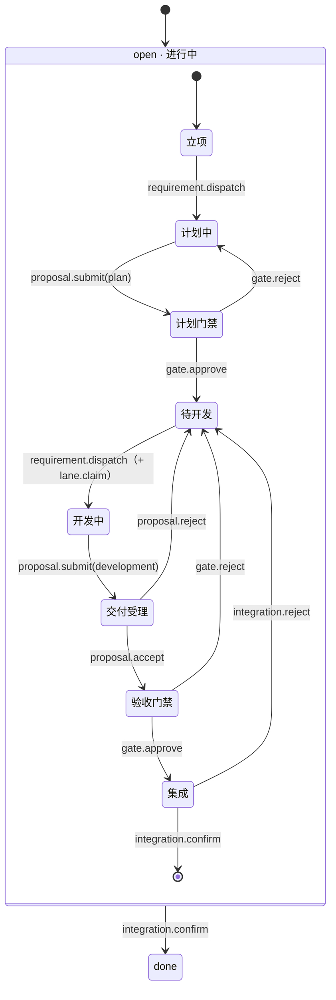

# Yggdrasill · 需求级剧情（open）

> **定位**：需求九幕微状态表、转场表与旁路/覆盖层语义（含 open→done mermaid）。
> **replaces**：DESIGN §2.4（L145–205）（搬运基线 `3a2536f`）
> **上游**：[docs/README.md](../README.md) · **相关**：[run-story.md](run-story.md) · [state-surface.md](state-surface.md) · [lanes.md](lanes.md)
> **搬运**：以下正文自 DESIGN.md L145–L205 逐字迁移，不重写语义。

### 2.4 需求级剧情（`open`）

每个需求在 `open` 内走过九幕（微状态），第 9 幕 `done` 即终态。三条打回路径（交付受理 `proposal.reject`、验收门禁 `gate.reject`、集成 `integration.reject`）**统一落待开发**（R6：`plan_ok` 保持、`job=""`、释放泳道）。

**九幕微状态表**（判定序见 §2.5）：

| # | 微状态 | 判据 | 主人 | 进入事件 | 退场事件 | 产出证据 |
| --- | --- | --- | --- | --- | --- | --- |
| 1 | **立项** | 无 job ∧ 无门禁 ∧ 无待决提案 ∧ `plan_ok=false` | 人 | `requirement.add` | `requirement.dispatch` | 需求描述 |
| 2 | **计划中** | `job=="plan"` ∨ 有 pending plan 提案 | 执行者 | ↑ | `proposal.submit(plan)` | `artifacts/rN-plan.md` |
| 3 | **计划门禁** | `gate=="plan"` | **人** | ↑ | `gate.approve` / `gate.reject` | 门禁批注 |
| 4 | **待开发** | `plan_ok=true` ∧ `job==""` ∧ 无 pending | **资源**（泳道槽位） | `gate.approve` | `requirement.dispatch` | 泳道认领记录 |
| 5 | **开发中** | `job=="development"` | 执行者 | ↑ | `proposal.submit(development)` | `artifacts/rN-development.md` + `develop@<sha>` |
| 6 | **交付受理** | 有 pending development 提案 | 主代理 | ↑ | `proposal.accept` / `proposal.reject` | 受理记录 |
| 7 | **验收门禁** | `gate=="accept"` | **人** | `proposal.accept` | `gate.approve` / `gate.reject` | 门禁批注（须核验 `develop@<sha>`） |
| 8 | **集成** | `integrating=true` | 执行者 | `gate.approve` | `integration.confirm` / `integration.reject` | `develop@<sha>` 核验记录 |
| 9 | **done**（终态） | `status=="done"` | — | `integration.confirm` | — | 集成证据；旁路关闭时为 `closed_reason` |

保留「交付受理」的**不对称**（定稿 2026-11-12）：计划提案一过门禁即待开发，开发交付多一道主代理受理幕——开发交付的复核成本更高，受理幕是协调层的串行检查点。

**转场表**（副作用中的键见 §2.8；三条打回行 = R6 修正版）：

| 从 | 事件 | 到 | 副作用 |
| --- | --- | --- | --- |
| 立项 | `requirement.dispatch` | 计划中 | `job="plan"` |
| 计划中 | `proposal.submit(plan)` | 计划门禁 | `job=""`、提案落库、`gate_rev=rev` |
| 计划门禁 | `gate.approve` | 待开发 | `plan_ok=true`、`gate=""`；响应式自动派发可同回合续进开发中（§2.9） |
| 计划门禁 | `gate.reject` | 计划中 | `plan_ok=false`、`rev+1`、写 `feedback` |
| 待开发 | `requirement.dispatch` | 开发中 | `job="development"` + `lane.claim` |
| 开发中 | `proposal.submit(development)` | 交付受理 | `job=""`、提案落库、**不释放泳道**（R7） |
| 交付受理 | `proposal.accept` | 验收门禁 | stale 校验（`gate_rev==rev`）、复制 summary/artifacts |
| 交付受理 | `proposal.reject` | 待开发 | 提案置 rejected、`job=""`、释放泳道 |
| 验收门禁 | `gate.approve` | 集成 | `integrating=true`、`gate=""` |
| 验收门禁 | `gate.reject` | 待开发 | 写 `feedback`、`rev+1`、释放泳道 |
| 集成 | `integration.confirm` | done | 校验 `develop@<sha>`、`status="done"`、`LANES.release` |
| 集成 | `integration.reject` | 待开发 | 写 `feedback`、`integrating=false`、`LANES.release` |

**旁路与覆盖层**（不改幕，只改标志位）：`requirement.amend` 递增 `rev` 并使 `plan_ok` 失效——门禁挂起时 `gate_rev != rev` 呈现 stale、阻塞 `gate.approve`；修订 `done` 需求派生带 `origin=rN` 的新需求。`requirement.split` / `requirement.merge` 仅对开发前且无活动任务、门禁、泳道、冲突的需求有效——父/源需求落 `done` + `closed_reason`（R11）。`requirement.conflict` 在两需求间升起双向冲突（阻塞派发与收口），直到 `requirement.resolve`（`keep_both` / `keep_first` / `revise`）。`blocked`（冲突 / `needs_amend`）是 `req_display()` 叠加在 `req_phase()` 之上的**覆盖层**，不是微状态。

