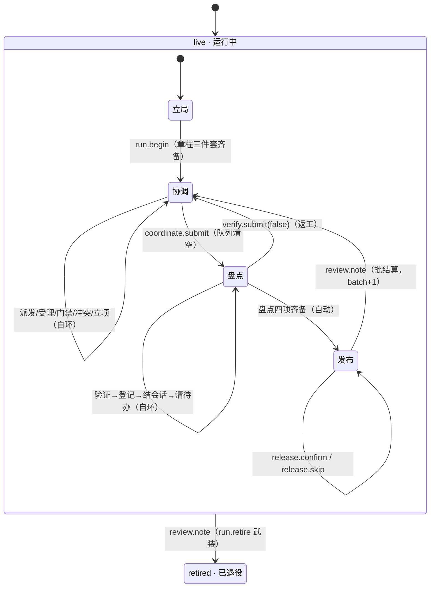

# Yggdrasill · 运行级剧情（live）

> **定位**：常驻自循环的运行级微状态表、开场序列、盘点子微状态与发布幕（含 live→retired 唯一转场 mermaid）。
> **replaces**：DESIGN §2.3（L96–144）（搬运基线 `3a2536f`）
> **上游**：[docs/README.md](../README.md) · **相关**：[requirement-story.md](requirement-story.md) · [state-machine.md](state-machine.md) · [events.md](events.md)
> **搬运**：以下正文自 DESIGN.md L96–L144 逐字迁移，不重写语义。

### 2.3 运行级剧情（`live`）

`live` 是常驻自循环：立局 → 协调 ⇄ 盘点 ⇄ 发布 → 批结算 → 下一批，往复运行直到显式退役。**内核 FSM 唯一转场是 `live → retired`**（R1，`review.note` 武装路径经 `flow.advance` 盖章）。

**微状态表**（判定序见 §2.5；「主人=人 ⇒ 票据门」见 §2.13）：

| 微状态 | 判据 | 主人 | 进入 | 退场 | 产出证据 |
| --- | --- | --- | --- | --- | --- |
| **立局** | `run.phase == "charter"` | 人（局主） | run 创建（`initial=live`，`run.phase` 初值 `charter`） | `run.begin` | 章程三件套 `task.title/goal/success` |
| **协调** | 章程齐 ∧ `run.phase == ""` | 主代理 | `run.begin` / 批结算 | `coordinate.submit` | 需求交付物、门禁批注 |
| **盘点** | `run.phase == "settle"` | 主代理 | `coordinate.submit` | 盘点四项齐备（自动转发布） | 验证证据、演进登记、结算声明 |
| **发布** | `run.phase == "release"` | **主代理**（develop→master） | 盘点四项齐备 | `release.confirm` / `release.skip` → 批结算或退役 | `master@<sha>` + tag `vYYYY.MM.DD.N`，或跳过理由 |
| 退役（终态） | `stage == "retired"` | — | `review.note`（`run.retire` 武装） | — | `ending` |

**开场序列**（R3）：`event.start` 叙述 boot 三则（引擎/模式/红线）并可携带章程载荷写入 `task.*`，**不转场**；`charter.set` 仅立局可用、可反复修订；`run.begin` 前置 = 章程三件套齐备，落点 `run.phase=""` 并发 `[RUN BEGUN]`。章程在 `run.begin` 后**锁定**（R4）：`charter.set` 在非立局微状态一律可读拒绝。

**盘点内子微状态**（线性推进；`verify.submit(false)` 使整批退回协调并清 settlement 与 release 键，R9）：

| 子微状态 | 判据 | 只允许 | 文案键 |
| --- | --- | --- | --- |
| 待验证 | `verify.passed ≠ true` | `verify.submit` | `verify_green` / `verify_fail` |
| 待登记演进 | `verify.passed` ∧ 未注册 | `settlement.evolution` | `settlement_evolution` |
| 待结会话 | 已登记 ∧ `settlement.sessions.destination == ""` | `settlement.sessions` | `settlement_sessions` |
| 待清待办 | 已登记 ∧ `settlement.todo.remaining ≠ 0` | `settlement.todo` | `settlement_todo` |
| 可进发布 | 以上皆完成 | （自动转发布幕，不新增事件） | — |

**发布幕**（R-a / R10）：盘点四项齐备（验证、演进登记、会话清理、待办清理）后自动进入发布微状态（R9，效应驱动）。`release.confirm` 携带 `master@<sha>` 与批次 tag `vYYYY.MM.DD.N` 声明本批 develop→master 合并结果；`release.skip` 必填理由——本批无需发布的显式声明。两者任一成立即「发布已声明」；`review.note` 的前置即发布已声明（`run.release.master_sha ≠ ""` ∨ `run.release.skipped_reason ≠ ""`），未声明的批结算被可读拒绝。

`review.note` 两个落点（R10）：**未武装（常态）= 批结算**——`run.phase=""`、清 release 键、`run.batch+1`、`[BATCH n SETTLED]`（绝无 `[ENDING` 前缀）；**`run.retire` 武装 = 退役终局**——`advance(retired)` 写 `ending`，`[ENDING · run retired]`。

**批结算自动维护追加（D-MA25，r3）**：未武装批结算在 `[BATCH n SETTLED]` 之后、同 handler 事务内自动 `req_append` 一条 draft 态「维护更新 docs wiki（上批收口）」需求（description 携 r2 wiki 树分文件指引，见 `beats-settlement.json` `maintenance_req_desc`）。防重复：注册表已存在 open ∧ 无 closed_reason ∧（`req.<i>.maintenance` 标记 ∨ 规范标题）的行则跳过；容量满同样跳过——追加尽力而为，只叙事不拒绝，绝不使批结算失败。退役路径不追加。追加行永不带 mark（draft 不被 auto_dispatch 推进），由主代理在下一批协调幕 `requirement.dispatch`，未 done 前阻塞下一批 `coordinate.submit`——每批一轮的文档维护节奏由此强制。

