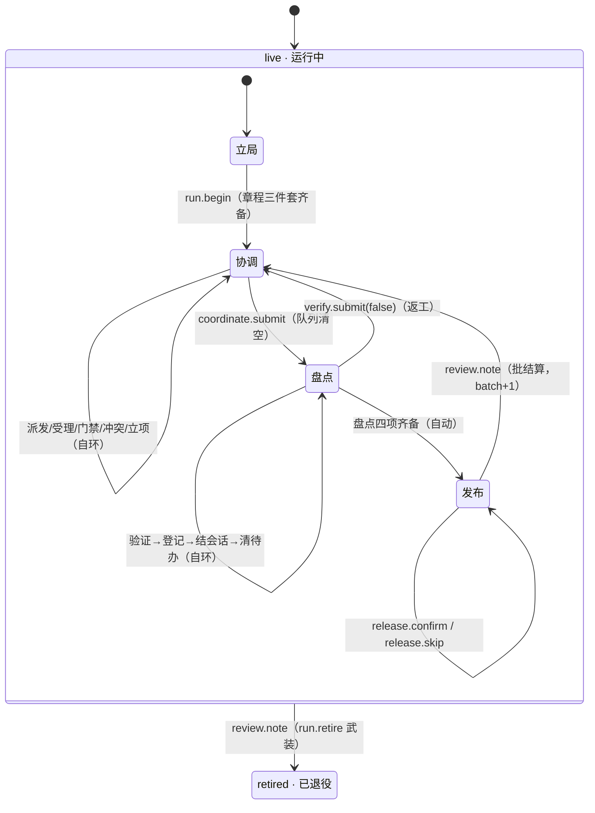

# 运行故事 — 一局怎么跑、在哪里转向

> **id** story/run-story · **幕** all · **触发** 理解一整局怎么跑，或改运行级转场之前
> **读不到代价** silent-drift（按记忆讲微状态 → 讲错转场与会话边界）
> **replaces**：`DESIGN` §2.3（L96–144）与 `docs/context/story/run-story.md`（搬运基线 `3a2536f`）
> **上游**：[../acts/prologue.md](../acts/prologue.md) · **相关**：[requirement-story.md](requirement-story.md) · [../../contracts/kernel/state-machine.md](../../contracts/kernel/state-machine.md) · [../../contracts/kernel/events.md](../../contracts/kernel/events.md)

`live` 是常驻自循环：立局 → 协调 ⇄ 盘点 ⇄ 发布 → 批结算 → 下一批，往复运行直到显式退役。**内核 FSM 的唯一转场是 `live → retired`**（R1；`review.note` 的武装路径经 `flow.advance` 盖章）。

## 微状态表

| 微状态 | 判据 | 主人 | 进入 | 退场 | 产出证据 |
| --- | --- | --- | --- | --- | --- |
| **立局** | `run.phase == "charter"` | 人（局主） | run 创建（`initial=live`，`run.phase` 初值 `charter`） | `run.begin` | 章程三件套 `task.title/goal/success` |
| **协调** | 章程齐 ∧ `run.phase == ""` | 主代理 | `run.begin` / 批结算 | `coordinate.submit` | 需求交付物、门禁批注 |
| **盘点** | `run.phase == "settle"` | 主代理 | `coordinate.submit` | 盘点四项齐备（自动转发布） | 验证证据、演进登记、结算声明 |
| **发布** | `run.phase == "release"` | **主代理**（`develop`→`master`） | 盘点四项齐备 | `release.confirm` / `release.skip` → 批结算或退役 | `master@<sha>` + tag `vYYYY.MM.DD.N`，或跳过理由 |
| 退役（终态） | `stage == "retired"` | — | `review.note`（`run.retire` 武装） | — | `ending` |

## 开场序列（R3 / R4）

`event.start` 叙述 boot 三则（引擎 / 模式 / 红线），可携带章程载荷写入 `task.*`，**不转场**；`charter.set` 仅立局可用、可反复修订；`run.begin` 的前置是章程三件套齐备，落点 `run.phase=""` 并发 `[RUN BEGUN]`。章程在 `run.begin` 后**锁定**：`charter.set` 在任何非立局微状态一律可读拒绝（`charter_locked`）。

## 盘点内的子微状态（线性推进）

| 子微状态 | 判据 | 只允许 | 文案键 |
| --- | --- | --- | --- |
| 待验证 | `verify.passed ≠ true` | `verify.submit` | `verify_green` / `verify_fail` |
| 待登记演进 | `verify.passed` ∧ 未注册 | `settlement.evolution` | `settlement_evolution` |
| 待结会话 | 已登记 ∧ `settlement.sessions.destination == ""` | `settlement.sessions` | `settlement_sessions` |
| 待清待办 | 已登记 ∧ `settlement.todo.remaining ≠ 0` | `settlement.todo` | `settlement_todo` |
| 可进发布 | 以上皆完成 | （自动转发布幕，不新增事件） | — |

`verify.submit(false)` 使**整批**退回协调并清掉 settlement 与 release 键（R9）——返工是把整批重新走一遍，不是就地改判。

## 发布幕

盘点四项齐备（验证、演进登记、会话清理、待办清理）后自动进入发布微状态（效应驱动）。`release.confirm` 携带 `master@<sha>` 与批次 tag `vYYYY.MM.DD.N`，声明本批 `develop`→`master` 的合并结果；`release.skip` 必填理由，是本批无需发布的显式声明。两者任一成立即「发布已声明」，而 `review.note` 的前置正是发布已声明——未声明的批结算被可读拒绝。

## `review.note` 的两个落点（R10）

- **未武装（常态）= 批结算**：`run.phase=""`、清 release 键、`run.batch+1`、`[BATCH n SETTLED]`（绝无 `[ENDING` 前缀）。
- **`run.retire` 武装 = 退役终局**：`advance(retired)` 写 `ending`，发 `[ENDING · run retired]`。

## 批结算的文档维护义务（用户 2026-11-15 裁定，主会话自办）

未武装的批结算在 `[BATCH n SETTLED]` 之后、同一 handler 事务内登记 `docs.maintenance.due=<batch>` 并叙述 `[DOCS MAINTENANCE DUE]`（含分文件指引与解除命令）。**它不派生需求行**——知识库维护是主会话的自身工作，subagent 缺跨批次上下文。义务靠**下一次 `coordinate.submit` 硬阻塞**闭环，解除命令 `config.set docs.maintenance.done=<batch>`（只认等值批次）。退役路径不追加，重复登记按已登记批次跳过。

## 判据

① 阻断——把 `coordinate.submit` 当批结算、在 `verify.submit(false)` 后就地补救、`review.note` 前不声明发布、把文档维护义务派给 subagent。② 症状——`[BATCH n SETTLED]` 后 `docs.maintenance.due` 仍空、下一批 `coordinate.submit` 被无理由阻塞、`stage` 与 `run.phase` 打架。③ 确认——`src/runtime/flow.lua` 的状态名与本页相同，`state-machine` 契约页给出同一张转场表。

维护责任 = 改运行级转场的人；触发 = 新增微状态、改批结算顺序、改章程锁定点；检查 = 本页五幕与 `flow.lua` 同名同序，`review.note` 两落点由 driver 测试覆盖。
